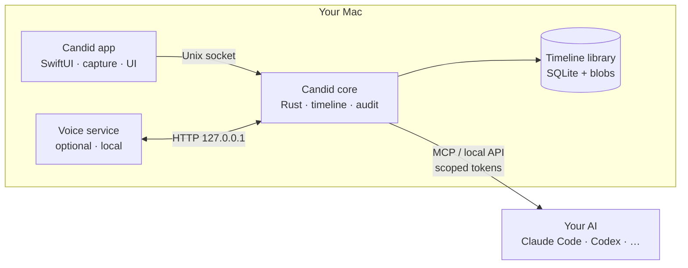

<div align="center">


# Candid

**Your day, on your Mac, for any AI.**

A local-first capture and context foundation: Candid quietly records what you choose, keeps it as evidence on your own machine, and lets the AI of your choice understand you — with scoped, audited, revocable access.

[](https://github.com/candid-oss/candid/actions/workflows/ci.yml)
[](LICENSE)


**English** · [中文](README.zh-CN.md)

</div>

> [!NOTE]
> Candid is in early development (0.1). Builds are not yet signed with a Developer ID. Expect rough edges, and please [report them](https://github.com/candid-oss/candid/issues).

## Why Candid

AI assistants are only as useful as what they know about you — and today you re-explain your context in every chat. The tools that capture that context tend to either upload it to someone else's cloud, or record everything and hand it over wholesale.

Candid takes the other path:

- 🔒 **Local first.** Everything stays on your Mac. No telemetry, no account, no cloud of ours.
- 👁️ **Visible capture.** Every launch starts paused. The dot in the menu bar always tells you whether Candid is recording.
- 🧾 **Evidence, not guesses.** Raw records, episodes and memories are stored separately; every AI inference keeps its source, model and confidence.
- 🔑 **Scoped access.** Each AI client gets its own token and scope. Every query is audited and can be revoked.
- 🧩 **Bring your own AI.** Claude Code, Codex or any MCP client reads your timeline through the same tools and permissions.

## What it captures

| Source | What is kept |
|---|---|
| 🖥️ Desktop activity | Apps, windows, focused and selected text, readable page text — per app, with exclusions |
| 📸 Screenshots | Only when you turn them on, for the apps you choose; OCR runs on device |
| 🎙️ Recordings | Microphone and system audio (e.g. calls), saved in segments that survive crashes |
| 🗣️ Speech | Optional local transcription and speaker separation (Apple Silicon) |
| ✉️ Mail & calendar | Mail.app data or IMAP, with filter rules; calendar and reminders on the AI page |
| 🤖 AI sessions | Your Claude Code and Codex prompts, linked to what you were doing |

## How it works



- **[core/](core/README.md)** — the Rust core: storage, ingest, query tools, permissions and audit, background processing, the MCP server and the `candid` CLI.
- **[apps/macos/](apps/macos/README.md)** — the SwiftUI app; it runs the core as a helper process.
- **[agents/](agents/README.md)** — the extension and skills for the attached agent on the AI page.
- **[services/voice/](services/voice/README.md)** — an optional local speech service.
- **[docs/](docs/README.md)** — design documents: timeline spec, agent platform, design system, decisions.

## Quick start

**Requirements:** macOS 14+, Apple Silicon recommended, Rust 1.88+, Xcode 26 or later (Swift 6.2+; CI builds with Xcode 26.3).

```bash
git clone https://github.com/candid-oss/candid.git
cd candid
```

```bash
apps/macos/script/build_and_run.sh
```

The app opens paused. Try it without touching real data:

```bash
apps/macos/script/build_and_run.sh --mock
```

Then, optionally:

- **AI page**: Settings → Components installs Node and the agent runtime on demand (nothing is bundled).
- **Transcription**: set up the [voice service](services/voice/README.md).
- **Your own AI**: Settings → External access registers a client and gives you a ready-made MCP snippet for Claude Code or Codex.

## Privacy and security

Candid is built around one promise: **nothing is recorded or sent without you knowing.** Read the [security model](SECURITY.md) for what is protected and how, and the known limits. Found a vulnerability? Please report it privately via **Security → Report a vulnerability**.

## Contributing

Contributions are welcome — see [CONTRIBUTING.md](CONTRIBUTING.md) for the ground rules (no surprise capture, local first, synthetic test data only), how to build and test each part, and how to sign off commits.

| Part | Test command |
|---|---|
| Rust core | `cd core && cargo test --workspace` |
| macOS app | `apps/macos/script/test.sh` |
| Voice service | `.venv-asr-mlx/bin/python -m pytest -q services/voice/tests` |

## License

Candid is licensed under the [Apache License 2.0](LICENSE). Third-party notices are in [THIRD_PARTY_LICENSES.txt](THIRD_PARTY_LICENSES.txt).
