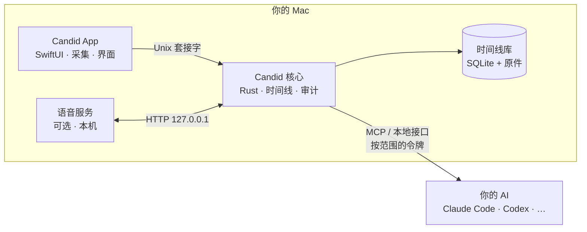

<div align="center">


# Candid

**你的一天，留在你的 Mac 上，交给你选择的 AI。**

一个本地优先的采集与上下文底座：Candid 安静地记录你选择记录的内容，作为证据保存在你自己的电脑上，再通过有范围、可审计、可撤销的方式，让你选择的 AI 理解你。

[](https://github.com/candid-oss/candid/actions/workflows/ci.yml)
[](LICENSE)


[English](README.md) · **中文**

</div>

> [!NOTE]
> Candid 处于早期开发阶段（0.1），安装包尚未使用 Developer ID 签名。难免有粗糙之处，欢迎[反馈问题](https://github.com/candid-oss/candid/issues)。

## 为什么做 Candid

AI 助手有多好用，取决于它有多了解你；可现在每开一个对话，你都要重新交代一遍背景。能帮你积累背景的工具，要么把数据传到别人的云上，要么什么都录、整包交出去。

Candid 选择另一条路：

- 🔒 **本地优先**：数据只在你的 Mac 上。没有遥测，不需要账号，没有我们的云。
- 👁️ **采集可见**：每次启动默认暂停，菜单栏的圆点始终告诉你 Candid 有没有在记录。
- 🧾 **证据优先**：原始记录、片段与记忆分层保存；每条 AI 推断都保留来源、模型与置信度。
- 🔑 **按范围授权**：每个 AI 客户端有独立令牌和范围，每次查询都有审计，随时可以撤销。
- 🧩 **AI 由你选**：Claude Code、Codex 或任何 MCP 客户端，都通过同一套工具和权限读取你的时间线。

## 能记录什么

| 来源 | 保存的内容 |
|---|---|
| 🖥️ 电脑活动 | 应用、窗口、焦点与选中文字、可读的页面文字；可按应用开关和排除 |
| 📸 截图 | 只在你开启并选择应用后记录；文字识别在本机完成 |
| 🎙️ 录音 | 麦克风与系统声音（例如通话），分段保存，崩溃也不丢 |
| 🗣️ 语音 | 可选的本地转写与说话人分离（Apple Silicon） |
| ✉️ 邮件与日程 | 本机「邮件」数据或 IMAP，可设筛选规则；日历与提醒显示在 AI 页 |
| 🤖 AI 会话 | 你在 Claude Code、Codex 里的指令，并关联到当时在做的事 |

## 工作方式



- **[core/](core/README.md)**：Rust 核心，负责存储、入库、查询工具、权限与审计、后台处理、MCP 服务和 `candid` 命令。
- **[apps/macos/](apps/macos/README.md)**：SwiftUI App，以辅助进程运行核心。
- **[agents/](agents/README.md)**：AI 页挂接 agent 的扩展与技能。
- **[services/voice/](services/voice/README.md)**：可选的本地语音服务。
- **[docs/](docs/README.md)**：设计文档，包括时间线规格、agent 平台、设计系统与决策记录。

## 快速开始

**环境**：macOS 14+，推荐 Apple Silicon，Rust 1.88+，Xcode 26 或更新版本（Swift 6.2+；CI 使用 Xcode 26.3 构建）。

```bash
git clone https://github.com/candid-oss/candid.git
cd candid
```

```bash
apps/macos/script/build_and_run.sh
```

App 启动后默认暂停。想先看看又不碰真实数据：

```bash
apps/macos/script/build_and_run.sh --mock
```

之后可以按需：

- **AI 页**：在「设置 → 组件」里按需安装 Node 和 agent 运行环境（App 不打包它们）。
- **转写**：部署[语音服务](services/voice/README.md)。
- **接入自己的 AI**：在「设置 → 外部访问」登记客户端，得到 Claude Code 或 Codex 可直接使用的 MCP 配置。

## 隐私与安全

Candid 的核心承诺只有一句：**没有你的知情，就不记录、不发送。** 保护了什么、怎么保护、已知的边界，见[安全说明](SECURITY.md)。发现漏洞请通过 **Security → Report a vulnerability** 私下报告。

## 参与贡献

欢迎贡献。硬规则（不做意外采集、本地优先、测试只用合成数据）、各部分的构建测试方式和 DCO 签署，见 [CONTRIBUTING.md](CONTRIBUTING.md)。

| 部分 | 测试命令 |
|---|---|
| Rust 核心 | `cd core && cargo test --workspace` |
| Mac App | `apps/macos/script/test.sh` |
| 语音服务 | `.venv-asr-mlx/bin/python -m pytest -q services/voice/tests` |

## 许可证

Candid 采用 [Apache License 2.0](LICENSE)。第三方声明见 [THIRD_PARTY_LICENSES.txt](THIRD_PARTY_LICENSES.txt)。
