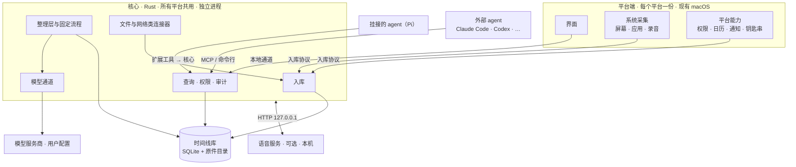

# 架构总图

**状态**：已实现的结构如实描述；第 8 节的多平台和第 9 节的欠账处理是计划，未实现。

本文是系统的地图：有哪些进程和模块、各管什么、数据怎么流、谁能依赖谁、往哪里扩展、现在欠着什么。
它不规定每一块内部的行为，那些在[规格](specs/README.md)里；也不解释为什么选 Rust 核心，那在 [ADR-024](decisions/024-rust-core.md)。

## 1. 概览

Candid 由一个跨平台的核心和每个平台一份的平台端组成。核心是唯一能打开数据库的进程；其他所有部分（界面、采集、挂接的 agent、外部 agent、命令行）都通过核心的接口读写。

五块及其边界：

| 块 | 位置 | 管什么 | 不管什么 |
|---|---|---|---|
| 核心 | `core/` | 存储、入库、整理、查询、权限与审计、模型调用与记账、固定流程、文件与网络类连接器、MCP、命令行 | 界面、系统接口 |
| 平台端 | `apps/macos/` | 界面、系统采集、系统权限、平台能力 | 业务逻辑、数据库、模型调用 |
| Agent | `agents/` | 挂接的 Pi 的扩展、系统提示和技能正文 | 自己的工具实现：工具调用全部转发给核心 |
| 语音服务 | `services/voice/` | 转写与说话人分离，可选的外部进程 | 存储：结果交回核心校验后入库 |
| 模型服务商 | 用户配置的地址 | 推理 | 只有核心和它通话 |

## 2. 进程与通道

运行时有这些进程：

| 进程 | 谁启动 | 说明 |
|---|---|---|
| Candid App | 用户 | SwiftUI 界面、菜单栏、采集、小组件数据 |
| 核心 `candid serve` | App，作为包内辅助进程（`Contents/Helpers/candid`） | 唯一打开 `timeline.sqlite` 和原件目录的进程。App 退出时它也退出；同一个数据根目录上的第二个核心以退出码 75 结束 |
| Pi | App（`PiAgent`），按需 | AI 页的对话和技能运行。只带 Candid 扩展提供的工具和模型，关闭自带工具 |
| `candid mcp` | 外部 agent | MCP 的 stdio 外壳，本身不打开数据库，转调运行中的核心 |
| `candid <命令>` | 用户或脚本 | 命令行，同样只是核心的客户端 |
| 语音服务 | 用户自行部署 | 可选。核心通过本机 HTTP 调用 |

进程之间的通道：

| 通道 | 两端 | 鉴权 | 用途 |
|---|---|---|---|
| 本地通道（Unix 域套接字，`/local/…`） | App ↔ 核心 | 只有当前用户能访问的套接字 | App 的读取、控制和入库。`/local/…` 在回环 HTTP 上一律返回 403 |
| 回环 HTTP（`127.0.0.1`，每次启动选空闲端口） | 命令行、MCP 外壳、Pi 扩展 ↔ 核心 | 每个访问方一个令牌，带范围 | 查询工具、提案、用量 |
| MCP（stdio） | 外部 agent ↔ `candid mcp` | 同上，经回环 HTTP | 外部 agent 的入口 |
| 运行目录（`endpoint.json`、命令行令牌，权限 0600） | 核心写，客户端读 | 文件权限 | 让客户端找到核心的地址 |

数据根目录（默认 `~/Library/Application Support/Candid/timeline/`）是位置无关的：整个目录搬到别处，用 `candid serve --root` 指过去即可。磁盘上所有位置的清单见[数据位置与迁移](data-migration.md)。

## 3. 模块

### 3.1 核心（约 3.6 万行 Rust）

| Crate | 行数 | 职责 |
|---|---|---|
| `candid-store` | 约 26,000 | 表结构与升级、入库（去重、幂等、原件校验）、删除与墓碑、整理层（对话、消息、摘录、活动块）、人物、条目、固定流程的状态、带范围过滤和审计的查询工具 |
| `candid-service` | 约 5,000 | 回环 HTTP 与本地通道、路由与鉴权、后台作业调度、模型调用、变更推送、MCP、Pi 运行、语音作业 |
| `candid-connectors` | 约 2,700 | 文件与网络类采集连接器：本机「邮件」数据、IMAP、浏览器历史 |
| `candid-cli` | 约 1,000 | `candid` 命令：`serve`、`mcp`、查询命令、`backup` / `restore` / `move-root` |
| `candid-metrics` | 约 900 | 离线的每日指标，跑在合成样例或只读时间线上 |
| `candid-lab` | 约 700 | 在真实数据副本上重放生产流程的实验工具，不随产品发布 |

依赖只有一个方向：`candid-cli` → `candid-service` → `candid-store`；`candid-service` → `candid-connectors` → `candid-store`。`candid-store` 不依赖其他任何一个。

提示词在 `core/prompts/`，固定流程目录在 `core/workflows/`，测试样例在 `core/fixtures/`。

### 3.2 Mac 平台端（约 3.7 万行 Swift）

| 模块 | 行数 | 职责 |
|---|---|---|
| `Candid/Views` | 约 14,900 | 页面 |
| `Candid`（顶层文件） | 约 10,100 | 页面的状态模型、采集会话、悬浮球、语音输入、Pi 进程管理 |
| `DesktopPlatform` | 约 2,800 | 屏幕与辅助功能采集、截图识别的平台侧 |
| `DesktopCore` | 约 1,600 | 采集到的事件映射成入库数据。名字带 Core，实际是平台端的一部分 |
| `AIProviders` | 约 1,500 | 模型来源的配置界面数据、钥匙串、连通性探测 |
| `Candid/Recording` | 约 1,400 | 录音采集、编码、本地发件箱 |
| `Candid/DesignSystem` | 约 1,100 | 组件与样式常量 |
| `TimelineConnectors` | 约 1,100 | 调系统接口的连接器：日历、提醒事项 |
| `CandidClient` | 约 850 | 本地通道客户端、核心进程管理、入库类型 |
| 其余（`ConsoleCore`、`Candid/System`、`DesktopDiagnostics`、小组件、本地化、共享） | 约 1,900 | |

### 3.3 Agent 与语音

- `agents/pi-extension/`：Pi 的扩展（把工具调用转发给核心）、系统提示、锁定的 Pi 版本。
- `agents/skills/`：五份技能正文，Pi 和外部 agent 共用。
- `services/voice/`：Python 语音服务。产品本体不依赖 Python：没有它，采集、保存、搜索、MCP 都照常，只是没有转写。

## 4. 四条数据路径

**写入。** 平台采集和各连接器把数据组织成入库批次（`IngestBatch`）交给核心。核心在一次事务里完成去重、落库、原件校验并推进同步位置。没有第二条写入路径。细节见[连接器与入库协议](specs/connectors.md)和[存储](specs/storage.md)。

**整理。** 核心的后台 worker 按固定流程（scan → 作业队列 → prepare → 模型 → complete）把原始记录整理成对话、消息、摘录、活动块、人物和条目。需要模型的步骤经模型通道调用。结果是派生数据，可以删除后重算。细节见[整理层](specs/curation.md)、[人物与条目](specs/people-items.md)、[固定流程](specs/workflows.md)。

**读取。** 界面经本地通道、Pi 经扩展、外部 agent 经 MCP，调用的是同一组查询工具，经过同一套范围过滤，每次调用写一条访问日志。细节见[查询接口](specs/query.md)。

**模型。** 所有模型请求由核心发出，按三个角色（`vision`、`summary`、`agent_chat`）路由到用户配置的来源，每次调用记一条用量。平台端需要模型时请核心代为调用。细节见[模型调用](specs/models.md)。

## 5. 依赖方向

这七条是结构性规则。违反任何一条都需要先有一条[决定](decisions/README.md)。

| # | 规则 | 怎么检查 |
|---|---|---|
| 1 | 只有核心打开数据库和原件目录 | Swift 里搜不到 SQLite 调用（2026-11-26 审计通过）；命令行和 MCP 外壳是客户端 |
| 2 | 写入只有一个入口：入库接口 | 连接器 crate 只依赖 `candid-store` 的入库接口 |
| 3 | 读取只有一套查询工具，权限过滤和审计也只有一套 | 契约测试、全流程测试 |
| 4 | 模型只由核心调用 | 靠自觉；现有一处例外，见第 9 节 |
| 5 | 平台端依赖核心，核心不知道平台端的存在。核心不依赖任何界面框架或平台框架 | `core/` 能在没有 Xcode 的环境编译和测试 |
| 6 | 平台端只做界面、系统采集、系统权限和平台能力。判断标准：换到 Windows 要不要重写？要，就不该在平台端 | 靠自觉；现存欠账见第 9 节 |
| 7 | Agent 的工具只转发，不自带逻辑；和外部 agent 用同一套权限 | Agent 端到端测试 |

## 6. 三个接缝：往哪里扩展

不做通用插件系统。要扩展时，从这三处之一进来：

| 想加的东西 | 走哪个接缝 | 规格 |
|---|---|---|
| 新的数据来源：一个应用、一种文件、一个平台的采集 | 入库协议：提交入库批次，由核心去重、落库、整理 | [连接器与入库协议](specs/connectors.md) |
| 新的消费方：一个 agent、一个脚本、一个界面 | MCP 工具或 `candid` 命令 | [查询接口](specs/query.md) |
| 新的 AI 行为：一种回顾、一种跟进 | 技能：`agents/skills/` 下的一份正文 | [固定流程与 agent](specs/workflows.md) |

三者都不够用时，才在核心里加一条固定流程，并在全流程测试里加数据和断言。

**为什么现在不做插件系统：**

- 接口还在变。现在开放，就是把没定型的东西变成对外承诺。
- 插件是不可信代码，读的却是最私密的数据。
- 插件的后台开销不受功耗规则约束。

**什么时候重新评估：** 有仓库外的人要写连接器，或者开始做第二个平台。那时的做法是让连接器作为独立进程经本地通道提交入库批次，不另造机制。前提是先给入库协议和本地通道补上快照，见[契约清单](contracts/README.md)的缺口。

## 7. 数据在哪

| 数据 | 位置 | 谁写 |
|---|---|---|
| 时间线库与原件 | 数据根目录 | 只有核心 |
| 采集设置、未投递的采集、录音会话 | App 的支持目录 | App |
| AI 对话、模型配置、调用记账的 App 侧副本 | App 的支持目录 | App。这是欠账，见第 9 节 |
| 密钥 | 系统钥匙串 | App 写入，经本地通道交给核心使用 |
| Pi 的会话与工作区 | 支持目录下的 `pi/` | Pi |

完整清单和备份时各项带不带走，见[数据位置与迁移](data-migration.md)。新增任何存储位置都要先进那张清单。

## 8. 多平台

核心是可移植的 Rust，时间线库是 SQLite，多平台的成本几乎全在平台端。平台端越薄，第二个平台越便宜。

| 平台 | 形态 | 前提 | 状态 |
|---|---|---|---|
| macOS | App 加辅助进程形式的核心 | | 已实现 |
| Windows | 新写平台端（界面、采集、权限）；核心复用；App 与核心之间用命名管道 | 还清第 9 节的欠账；本地通道有接口清单和快照；界面技术选型（ADR-024 留了 Tauri 与 WinUI 两个候选，未定） | 未实现 |
| 手机 | 卫星：录音、照片、分享入口加查看，数据同步到电脑上的核心。手机做不了持续的屏幕采集，也不适合常驻辅助进程 | 设备间同步的设计，目前没有 | 未实现 |
| NAS 或 Linux 主机 | 不带界面的 `candid serve` | 远程访问需要认证和 TLS，目前只监听本机 | 未实现 |

建议的顺序是 Mac 验证完成后做 Windows，最后是手机。这个顺序还没有拍板，见[待办](roadmap.md)。

## 9. 欠账

2026-11-26 对 Swift 端做了一次只读审计，对照第 5 节的规则。审计只读了代码，没有运行验证；行数是估计。

**守住了的：**

- Swift 里没有任何直接访问 SQLite 的代码。
- 对话和视觉识别的模型调用都经核心（`/local/models/complete`），不直连服务商。
- 录音、采集调度、核心通道的封装都在界限以内。

**越界的，按对多平台的影响排：**

| # | 问题 | 位置 | 规模 | 违反 |
|---|---|---|---|---|
| 1 | 截图识别的提示词拼装、证据裁切与结果回填在 Swift 里 | `DesktopPlatform/DesktopImageRecognition.swift`、`DesktopMarkdownEvidence.swift` | 约 320 行 | 规则 6 |
| 2 | 识别的批次、重试、引擎轮换调度在 Swift 里 | `Candid/DesktopRecognitionSession.swift` | 约 120 行 | 规则 6 |
| 3 | 云端语音转写由 Swift 直连服务商，不经核心，也不进调用记账 | `Candid/VoiceInput.swift` | 约 90 行 | 规则 4 |
| 4 | AI 对话存成 Swift 端的 JSON 文件，不在时间线库里；提示词与历史截断、技能提示词拼装也在 Swift | `Candid/AIConversation.swift`、`AIPageModel.swift`、`AISkills.swift`、`PromptCatalog.swift` | 约 250 行 | 规则 1、6 |
| 5 | 模型配置和用量在 Swift 端另存一份，再同步进核心 | `AIProviders/TemporaryStores.swift`、`Candid/AIRuntime.swift` | 约 150 行 | 规则 6 |
| 6 | Swift 里留着一整套直连模型的实现（回退链、日预算、记账、协议转换），只在测试时启用，与核心重复 | `AIProviders/AIClient.swift`、`Cost.swift`、`Wire.swift` | 约 600 行 | 重复实现 |
| 7 | 活动切分、内容签名去重、发送确认匹配这类推断逻辑在采集会话里 | `Candid/DesktopSession.swift`、`DesktopCore/` | 约 150 行 | 规则 6，灰色地带 |

合计不到两千行，问题是集中的，不是普遍的。

**其他结构问题：**

| 问题 | 说明 |
|---|---|
| `candid-store` 过大 | 一个 crate 约 2.6 万行，占核心的七成，模块边界靠约定。不急着拆；单个文件接近一千行时按职责拆子模块，见[工程规范](engineering.md#rust) |
| 旧媒体 Hub 的痕迹 | 磁盘上仍有 `MediaWorkspace/Hub/` 下的旧库，内容已镜像进时间线。它是否还有运行时职责（未验证） |
| 连接器没有统一接口 | 规格写的是每个连接器实现五个能力，代码里是一组按来源分发的函数。对第三方连接器是障碍，见[连接器](specs/connectors.md) |
| 没有开放格式导出 | 只有整库备份。见[契约清单](contracts/README.md) |

**处理原则：** 不单独开一次大重构。做 Windows 之前按表里的顺序逐项搬进核心，每项一个改动。在此之前，新代码不再往这些位置加逻辑；碰到相关改动时优先搬。第 3 项涉及记账的完整性，建议最先做。

## 10. 这页怎么保持为真

- 加一块、改一条依赖规则或加一个接缝，先记一条[决定](decisions/README.md)，再改本页。
- 第 9 节还一项划一项；新发现的越界加进表里，不留在聊天记录里。
- 第 3 节的行数是量级，不必每次改动都更新；差出一倍时更新。

## 11. 来源

- 进程边界和三个部分的划分：[ADR-024](decisions/024-rust-core.md)。
- 组件与通道：旧时间线库规格第 2 节，见[搬迁对照](specs/timeline-v1.md)。
- 第 9 节：2026-11-26 的 Swift 端只读审计。
