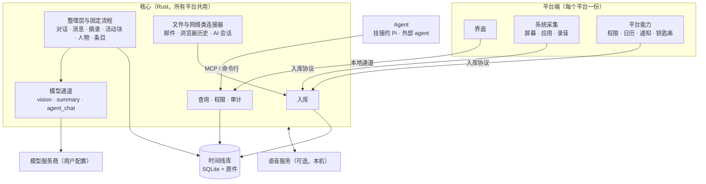

# 架构总图

这一页是系统的地图：有哪几块、各管什么、谁能依赖谁、往哪里扩展、现在欠着什么。细节在各规格里，这里只保留一个人脑子里放得下的部分。

## 1. 五块

| 块 | 位置 | 管什么 | 不管什么 |
|---|---|---|---|
| 核心 | `core/` | 存储、入库、整理、查询、权限与审计、模型调用、固定流程、文件与网络类连接器、MCP、命令行 | 界面、系统接口 |
| 平台端 | `apps/macos/`，以后的 Windows 与手机 | 界面、系统采集、系统权限、平台能力 | 业务逻辑、数据库、模型调用 |
| Agent | `agents/` | 挂接的 Pi 的扩展与技能正文 | 自己的工具实现：工具都转发给核心 |
| 语音服务 | `services/voice/` | 转写与说话人分离，可选的外部进程 | 存储：结果交回核心校验入库 |
| 模型服务商 | 用户配置 | 推理 | 只有核心和它通话 |

## 2. 依赖方向

1. 平台端依赖核心，核心不知道平台端的存在。
2. 平台端只通过两条路和核心往来：本地通道（读、控制）和入库协议（写）。
3. 模型只由核心调用。平台端要用模型，请核心代为调用，这样预算、记账和审计才是完整的。
4. Agent 只通过 MCP 或命令行读写，和外部 agent 走同一套权限。
5. 核心内部：`candid-cli` → `candid-service` → `candid-store`；`candid-connectors` 只依赖 `candid-store` 的入库接口。

## 3. 三个接缝：往哪里扩展

不做通用插件系统。要扩展时，从这三处之一进来：

| 想加的东西 | 走哪个接缝 | 契约 |
|---|---|---|
| 新的数据来源（一个应用、一种文件、一个平台的采集） | 入库协议：提交 `IngestBatch`，由核心去重、落库、整理 | [时间线库 §6.1](specs/timeline-v1.md) |
| 新的消费方（一个 agent、一个脚本、一个界面） | MCP 工具或 `candid` 命令 | [契约清单](contracts/README.md) |
| 新的 AI 行为（一种回顾、一种跟进） | 技能：`agents/skills/` 下的一份正文 | [agents/README](../agents/README.md) |

三者都不够用时，才考虑核心里加一条固定流程（scan → 作业队列 → prepare → 模型 → complete），并在全流程测试里加数据和断言。

**为什么现在不做插件系统：** 接口还在变，现在开放就是把没定型的东西变成承诺；插件是不可信代码，读的却是最私密的数据；插件的后台开销不受功耗规则约束。

**什么时候重新评估：** 有仓库外的人要写连接器，或者开始做第二个平台。到那时的做法是让连接器作为独立进程经本地通道提交 `IngestBatch`，不需要另造一套机制。前提是先补上入库协议和本地通道的快照（见契约清单的缺口）。

## 4. 多平台

核心是可移植的 Rust，时间线库是 SQLite，所以多平台的成本几乎全在平台端。平台端越薄，第二个平台越便宜。

| 平台 | 形态 | 前提 |
|---|---|---|
| macOS | 现有 | |
| Windows | 新写平台端（界面、采集、权限），核心复用 | 先还清第 5 节的欠账，否则留在 Swift 里的逻辑都要重写一遍；先补本地通道的接口清单 |
| 手机 | 卫星：录音、照片、分享入口加查看，数据同步到电脑上的核心。手机做不了持续的屏幕采集 | 需要先有设备间同步的设计，目前没有 |

建议的顺序见[产品定位 §8](product.md)。

## 5. 欠账

2026-11-26 对 Swift 端做了一次只读审计，对照「逻辑在核心，平台层薄」。结论：

**守住了的：**

- Swift 里没有任何直接访问 SQLite 的代码。
- 对话和视觉识别的模型调用都经核心（`/local/models/complete`），不直连服务商。
- 录音、采集调度、核心通道的封装都在界限以内。

**越界的，按对多平台的影响排：**

| # | 问题 | 位置 | 规模 |
|---|---|---|---|
| 1 | 截图识别的提示词拼装、证据裁切与结果回填在 Swift 里 | `DesktopPlatform/DesktopImageRecognition.swift`、`DesktopMarkdownEvidence.swift` | 约 320 行 |
| 2 | 识别的批次、重试、引擎轮换调度在 Swift 里 | `Candid/DesktopRecognitionSession.swift` | 约 120 行 |
| 3 | 云端语音转写由 Swift 直连服务商，不经核心，也不进调用记账 | `Candid/VoiceInput.swift` | 约 90 行 |
| 4 | AI 对话存成 Swift 端的 JSON 文件，不在时间线库里；提示词与历史截断、技能提示词拼装也在 Swift | `Candid/AIConversation.swift`、`AIPageModel.swift`、`AISkills.swift`、`PromptCatalog.swift` | 约 250 行 |
| 5 | 模型配置和用量在 Swift 端另存一份，再同步进核心 | `AIProviders/TemporaryStores.swift`、`Candid/AIRuntime.swift` | 约 150 行 |
| 6 | Swift 里留着一整套直连模型的实现（回退链、日预算、记账、协议转换），只在测试时启用，与核心重复 | `AIProviders/AIClient.swift`、`Cost.swift`、`Wire.swift` | 约 600 行 |
| 7 | 活动切分、内容签名去重、发送确认匹配这类推断逻辑在采集会话里 | `Candid/DesktopSession.swift`、`DesktopCore/` | 约 150 行，属于灰色地带 |

**另外两处结构问题：**

- `candid-store` 一个 crate 约 2.6 万行，占 Rust 代码的七成。现在能用，模块边界靠约定。不急着拆；规则见[工程规范 §2](engineering.md)。
- Swift 约 3.7 万行，其中界面（`Views`、`DesignSystem`）约 1.6 万行。上表越界部分合计不到两千行，问题是集中而不是普遍。

**处理建议：** 不单独开一个大重构。做 Windows 之前按表里的顺序逐项搬进核心，每项一个改动；在此之前，新代码不再往这些位置加逻辑。第 3 项涉及「模型只由核心调用」和记账完整性，建议最先做。

审计只读了代码，没有运行验证；行数是估计。

## 6. 这页怎么保持为真

- 加一块、改一个依赖方向或加一个接缝，要先有一条决策记录。
- 第 5 节的欠账还一项划一项；新发现的越界加进表里，不留在聊天记录里。
