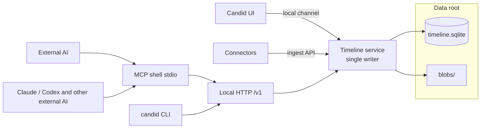

# Timeline library, query interface and connectors v1

[中文](timeline-v1.md) · **English**

**Status**: written spec. Slices T1–T6 are implemented (section 10); T7 is not. Mac desktop capture writes directly into this library through the ingest API; the old desktop ledger is retired read-only after verification (§9.1). The timeline UI reads from this library. The public envelope, references and portable packages follow artifact v1; Mac capture rules follow the desktop capture spec; model roles and processing pipelines follow the intelligence spec. This document defines only the shared storage, query interface and source integration between them.

<a id="decisions"></a>

## 1. Settled choices

Decisions:

1. **The data layer is location-independent.** It can live on this Mac, a NAS or another host, starting with a local service on the Mac. Data in any location can be fully migrated and exported.
2. **External AI first.** Claude, Codex and others read the timeline through standard interfaces.
3. **Simple features run automatically inside the core; conversations with AI in the app and hook-started skills run on the attached Pi; external AI connects through MCP/API, with the same tools.** The core has no tool loop of its own.
4. **Model sources are managed in one place.** Local open models and cloud APIs are configured together, and usage and cost are recorded.
5. **Connectors extend the timeline.** Sources include phones, mailboxes, AI session logs (Codex, Claude), system calendars, MCP and more. The timeline's backbone need not be screenshots; it can be made of richer events.
6. **Spec, schema and usage accounting first**, then AI and proactive features.
7. **AI agent sessions: what you say is stored, the AI's replies are only referenced.** Codex, Claude Code, WorkBuddy, pi, dsh and other agents are each a separate connector, and the user separately authorizes reading, search and activity for each; all are off by default. With "include in activity" on, the messages you send to the AI, session start and end, and work summaries are written to the timeline and shown as an "AI interaction" lane parallel to screenshots. Replies, tool output and reasoning stay in the agent's own files and are read live when needed. Rationale: instructions to an AI are your most deliberate input and weigh more than passive screen activity; agents clean up old sessions themselves (Claude Code after about 30 days by default), so referencing alone would lose those words. See [section 6.2](#agent-connectors).

Engineering design (implementation status in section 10):

- Only one timeline service process holds the database. The UI, MCP, the CLI, pi and connectors go through interfaces and never open SQLite directly.
- Events have one unified structure. AI-derived content is stored in layers and can be deleted and regenerated.
- Text is stored deduplicated by paragraph, with attention markers.
- Every AI call is recorded in one usage table.

<a id="deployment"></a>

## 2. Service, data root and migration

### 2.1 Components



- **Timeline service**: the only component that reads and writes the database and blob directory. On desktop it is the Rust core's own process ([ADR-024](../decisions/024-rust-core.en.md)), started and supervised by the app, listening on loopback HTTP and on a local channel reserved for the app. It can later run on a NAS with the same interface.
- **MCP shell and CLI**: thin HTTP clients; they open neither the database nor the blob directory.
- **Location independence**: the service finds all data through one "data root". Move the directory, or start the service on another host with the same directory, and all data is available.

> SQLite must not live on an SMB/NFS share opened remotely by another machine (file locks are unreliable). When data lives on a NAS, the service must run on the NAS host and the Mac uses HTTP; the Mac must never open a mounted database file.

Remote access requires authentication and TLS, per the privacy rules. The first version listens only on `127.0.0.1`.

Implemented: the service is the helper `Contents/Helpers/candid serve` inside the app bundle (the Rust core), with the data root at `~/Library/Application Support/Candid/timeline/` by default; loopback HTTP picks a free port at each start and writes it to `endpoint.json`; the CLI and MCP shell are the same `candid` binary.

### 2.2 Data root layout

```text
<root>/
  store.json                  # library identity and version, see below
  timeline.sqlite             # plus -wal, -shm
  blobs/sha256/<first 2>/<full hash>.<ext>
  staging/                    # ingest staging; crash recovery on start per desktop capture v1 §6.2
  exports/                    # export output (can be moved elsewhere)
  logs/                       # rolling diagnostic logs, no content
```

`store.json`:

| Field | Type | Meaning |
|---|---|---|
| `store_id` | UUID | Library identity, fixed at creation; referenced by exports and sync |
| `schema_version` | integer | Equals `PRAGMA user_version`; a library with a newer version refuses writes from an older service |
| `created_at` | RFC 3339 | Creation time |
| `created_by` | string | Program and version that created it, e.g. `candid/0.10.0` |
| `layout` | string | Always `timeline-root/1` |

API keys, OAuth tokens and access tokens are **never** stored in the data root. Secrets live in the host's secret store (Keychain on Mac); the library keeps only references.

### 2.3 Migration and export

- **Whole-library migration**: stop the service, copy the entire data root as is (with SQLite's backup API, or while stopped), then start the service at the new location. The service checks `store.json`, the schema version and the hashes of sampled blobs.
- **Export**: artifact v1 portable packages with three scopes (`agent_text`, `evidence_selected`, `full_owned`). A package can be read without this service or any model.
- **Import**: staged, then verified, written idempotently by `(source_id, source_key)` and `(artifact_id, revision)`; conflicts go to a conflict area and never overwrite existing data.

<a id="conventions"></a>

## 3. Conventions

| Item | Convention |
|---|---|
| IDs | Lowercase UUIDv7 text (time-ordered). A source's native ID is never the primary key; it goes in `source_key` |
| Time | Integer milliseconds UTC, field names ending in `_ms`, plus the local `tz_offset_min`. Spans are half-open `[start_ms, end_ms)`; an empty `end_ms` means a point in time or not yet ended |
| Time basis | `time_basis`: `observed` (seen on this machine), `source` (reported by the source), `imported` (only the import time is known), `estimated`. Plus `time_uncertainty_ms` |
| JSON | `TEXT` columns, validated before writing. `*_json` columns carry a version field or a fixed structure; unknown fields are preserved |
| Tables | Always `STRICT`. Foreign keys on, WAL mode, a single writer connection |
| Enums | `CHECK` constraints; a new value bumps the schema version and adds tests |
| Deletion | Writes a tombstone and removes derived content (section 5.8). No "soft-deleted but still queryable" |
| Revisions | Fact events are never rewritten; corrections create new events or revisions. Derived layers are identified by `(id, rev)` |

<a id="schema"></a>

## 4. Data model

The SQL below shows the logical structure; the runtime schema is defined by `core/crates/candid-store/src/schema.rs`. The current schema version is 8 (v8 adds per-entry agent session checkpoints, per-file duplicate message counts and a separate media projection change counter; v7 adds a separate `mac.system_audio` source, keeping source references, authorization and background invalidation triggers; v6 adds indexes for source keys, active jobs and recording segments plus internal background change counters; v4 adds mail and browser-history source kinds, the `quoted` text field, the `source_deleted` tombstone reason and `browser.visit`; v5 adds derived summaries and entity tables, extended memory and correction values, and the feature a job belongs to, see [§4.8.1](#derived-next)). Upgrades from v1–v7 run in a transaction and recover from interruption; the public artifact envelope stays at 1.0. Background work skips unchanged scans using change counters kept inside transactions, and reads pending/due jobs separately from history lists; source authorization is still checked at execution and write-back. The old `ai.turn`, `ai_session` and old source kinds remain only for migration compatibility and are never produced by new connectors.

### 4.1 Sources and sync progress

```sql
CREATE TABLE sources (
  source_id      TEXT PRIMARY KEY,                 -- UUIDv7
  kind           TEXT NOT NULL CHECK (kind IN (
                   'mac.desktop','mac.microphone','mac.system_audio','mac.region','media.import',
                   'device.pendant','phone.android','calendar.system','reminders.system',
                   'mail.imap','mail.gmail','mail.apple','browser.history','agent.transcript','mcp.remote','manual')),
  display_name   TEXT NOT NULL,
  device_id      TEXT,                             -- capturing device or host identity, optional
  account_ref    TEXT,                             -- reference to an external account (no credentials)
  secret_ref     TEXT,                             -- Keychain entry reference, optional
  config_json    TEXT NOT NULL DEFAULT '{}',       -- the connector's own settings, with a version field
  policy_json    TEXT NOT NULL,                    -- see below
  status         TEXT NOT NULL CHECK (status IN ('active','paused','error','revoked')),
  last_sync_ms   INTEGER,
  last_error     TEXT,                             -- error code from a bounded set, no content
  created_ms     INTEGER NOT NULL,
  updated_ms     INTEGER NOT NULL
) STRICT;

CREATE TABLE source_cursors (
  source_id   TEXT NOT NULL REFERENCES sources(source_id) ON DELETE CASCADE,
  stream      TEXT NOT NULL,          -- e.g. 'calendar:<calendar ID>', 'sessions'
  cursor      TEXT NOT NULL,          -- opaque, connector-defined; advanced only after the ingest transaction commits
  updated_ms  INTEGER NOT NULL,
  PRIMARY KEY (source_id, stream)
) STRICT;
```

The v8 durable agent checkpoint consists of `agent_session_entries` (source, session, entry identity and category, the redacted admitted entry) and `agent_file_counts` (source, file, content hash, occurrence count). Both exist only for recovery and deduplication, inherit the source's authorization and deletion boundaries, and never turn reply or tool-output text into stored facts. The progress cursor, changed entries and admitted events commit in one transaction; old inline checkpoints are converted the next time that session syncs, keeping the old state on failure. The media projection uses its own `media_projection` revision domain, invalidated only by changes to media inputs, related authorization and annotations; unrelated session health and role model settings do not trigger reprojection.

A source with `kind='agent.transcript'` keeps only its authorization state and path settings while "include in activity" is off, and produces no `events`, `threads` or `event_text` rows; once on, it produces only `ai.prompt` and `ai.work` events and `agent_session` threads, see [section 6.2](#agent-connectors).

`policy_json` (privacy and scope settings of capture sources; settings for referencing agent sources are in section 6.2):

```jsonc
{
  "version": 1,
  "store_text": true,          // store text; false keeps metadata only
  "store_media": false,        // store originals (images, audio, attachments)
  "agent_visible": true,       // visible to agents by default; client scopes still apply
  "retention_days": null,      // retention for this source; null follows the global setting
  "exclude": {"apps": [], "threads": [], "patterns": []}
}
```

### 4.2 Events: the single line of facts

```sql
CREATE TABLE events (
  event_id          TEXT PRIMARY KEY,
  source_id         TEXT NOT NULL REFERENCES sources(source_id),
  source_key        TEXT NOT NULL,          -- source-native ID or durable import ID; used for idempotency
  kind              TEXT NOT NULL REFERENCES event_kinds(kind),
  start_ms          INTEGER,                -- empty when unknown, then time_basis='imported'
  end_ms            INTEGER CHECK (end_ms IS NULL OR start_ms IS NULL OR end_ms >= start_ms),
  tz_offset_min     INTEGER,
  time_basis        TEXT NOT NULL CHECK (time_basis IN ('observed','source','imported','estimated')),
  time_uncertainty_ms INTEGER,
  app_bundle_id     TEXT,                   -- app identifier; empty for non-app sources
  app_name          TEXT,
  title             TEXT,                   -- window title, event title, mail subject, session name
  url               TEXT,                   -- credentials, query string and fragment removed
  thread_id         TEXT REFERENCES threads(thread_id),
  parent_event_id   TEXT REFERENCES events(event_id),  -- e.g. which focus observation a screenshot belongs to
  actor             TEXT NOT NULL DEFAULT 'self' CHECK (actor IN ('self','other','agent','system','unknown')),
  sensitivity       TEXT NOT NULL DEFAULT 'normal' CHECK (sensitivity IN ('normal','sensitive','protected')),
  payload_version   INTEGER NOT NULL,
  payload_json      TEXT NOT NULL,          -- structure per kind, see 4.3
  ingest_seq        INTEGER NOT NULL UNIQUE,-- monotonic, for the change feed and paging snapshots
  ingested_ms       INTEGER NOT NULL,
  UNIQUE (source_id, source_key)
) STRICT;

CREATE INDEX events_time   ON events(start_ms, event_id);
CREATE INDEX events_app    ON events(app_bundle_id, start_ms) WHERE app_bundle_id IS NOT NULL;
CREATE INDEX events_kind   ON events(kind, start_ms);
CREATE INDEX events_thread ON events(thread_id, start_ms) WHERE thread_id IS NOT NULL;
CREATE INDEX events_source ON events(source_id, start_ms);
CREATE INDEX events_parent ON events(parent_event_id) WHERE parent_event_id IS NOT NULL;
```

- **Sort key**: the timeline sorts by `(COALESCE(start_ms, ingested_ms), event_id)`. Events with unknown time are grouped separately in the UI and never pretend to a time of occurrence.
- **Idempotency**: syncing the same source record again adds no row; the same `source_key` with different content goes to `ingest_conflicts` and does not overwrite.
- **Protected content**: events with `sensitivity='protected'` keep metadata only and never store text or screenshots (password fields, windows marked protected).

```sql
CREATE TABLE event_kinds (          -- registry, updated with the schema version
  kind         TEXT PRIMARY KEY,
  layer        TEXT NOT NULL CHECK (layer IN ('evidence','perception')),
  is_span      INTEGER NOT NULL,    -- 1 = has a duration
  payload_version INTEGER NOT NULL,
  description  TEXT NOT NULL
) STRICT;

CREATE TABLE ingest_conflicts (
  source_id   TEXT NOT NULL, source_key TEXT NOT NULL,
  existing_event_id TEXT NOT NULL, incoming_json TEXT NOT NULL,
  detected_ms INTEGER NOT NULL, resolved_ms INTEGER, resolution TEXT,
  PRIMARY KEY (source_id, source_key, detected_ms)
) STRICT;
```

### 4.3 Event kinds and payloads (v1)

| kind | Layer | Span | Sources | Payload fields |
|---|---|---|---|---|
| `app.focus` | evidence | yes | mac.desktop | `{reason}` (switch, wake, resume) |
| `window.focus` | evidence | yes | mac.desktop | `{window_token, coverage: "app"\|"window"}` |
| `screen.text` | evidence | no | mac.desktop | `{trigger, text_status, focused_role, focused_label, is_composing, reader: {version, deep_pass: bool, nodes}}`. Text is not in the payload; it lives in `event_text` |
| `screen.shot` | evidence | no | mac.desktop, mac.region | `{trigger, pixel_w, pixel_h, scale, source_bounds, ax_evidence_ref?}`; the original is linked through `event_blobs` |
| `marker` | evidence | no | any | `{label?, note?}` |
| `system.state` | evidence | no | mac.desktop | `{change: "power"\|"sleep"\|"wake"\|"lock"\|"unlock"\|"session", value}` |
| `coverage.gap` | evidence | yes | any | `{reason_code}` (paused, permission_denied, asleep, crashed, source_offline) |
| `audio.recording` | evidence | yes | mac.microphone, mac.system_audio, device.pendant, media.import | `{codec, sample_rate, channels, duration_ms, origin_filename?}` |
| `image.capture` | evidence | no | mac.region, phone.android, media.import | `{pixel_w, pixel_h, origin_filename?, exif_time?}` |
| `speech.segment` | perception | yes | ASR job | `{recording_event_id, sample_start, sample_end, speaker_label?, speaker_candidate?, asr: {model_id, revision}}`; text in `event_text` |
| `image.text` | perception | no | OCR / VLM job | `{image_event_id, method: "ax"\|"ocr"\|"vlm", model_id?, regions_ref?}` |
| `calendar.event` | evidence | yes | calendar.system | `{calendar_id, calendar_name, all_day, location?, attendees: [{name?, email_hash?}], status, recurrence_id?}` |
| `reminder.item` | evidence | no | reminders.system | `{list_name, due_ms?, completed_ms?, priority?}` |
| `mail.message` | evidence | no | mail.apple, mail.imap | `{adapter, direction: "in"\|"out", from: {name?, address_hash?}, to_count, cc_count, has_attachments, attachments: [{name?, mime, size}], mailboxes: [..], account?, level, level_basis, ai_judge?, body_status: "complete"\|"partial"\|"not_downloaded"\|"undecodable", body_format, list, automated, quoted_chars, signature_chars, revision?}`; text fields `subject`, `body` (newly written part), `quoted` (quoted history and signature, excluded from extraction input); with `level=metadata` only the subject is stored |
| `browser.visit` | evidence | no | browser.history | `{browser, visit_count}`; `url` without credentials, query string or fragment; registered in v4, **import not enabled** |
| `note` | evidence | no | manual | `{format: "text"\|"markdown"}` |
| `ai.prompt` | evidence | no | agent.transcript; screen fallback per records-v1 | `{agent, session_ref, message_ref, project?, followups: n, truncated: bool, origin: "transcript"\|"screen"}`; your words go to `event_text` (field `prompt`), follow-ups merge into the same event |
| `ai.work` | evidence | yes | agent.transcript | `{agent, session_ref, prompt_event_id, status: "done"\|"running"\|"interrupted", assistant_messages, tool_calls: {name: count}, files_touched, tokens?}`; no reply text |

- A new kind registers in `event_kinds`, provides payload validation and tests, and then gets a row in this table.
- Email addresses and attendee emails are stored only as salted hashes, to tell whether two are the same person; plain addresses appear only in person records the user separately authorizes.
- For AI agent sessions only your messages (`ai.prompt`) and work summaries (`ai.work`) are stored; reply text is not (section 6.2). The former `ai.turn` is no longer used. Implementing these two events and the `agent_session` thread kind raised the schema to version 2, with transactional upgrade of old libraries and verified failure recovery; `agent_event_revisions` keeps per-revision snapshots of received messages and statistics, and indexes point only at the current revision.

### 4.4 Threads: meetings, conversations, mail threads

```sql
CREATE TABLE threads (
  thread_id    TEXT PRIMARY KEY,
  source_id    TEXT NOT NULL REFERENCES sources(source_id),
  source_key   TEXT NOT NULL,
  kind         TEXT NOT NULL CHECK (kind IN ('mail_thread','meeting','recording','calendar_series','chat','agent_session')),
  title        TEXT,
  started_ms   INTEGER,
  ended_ms     INTEGER,
  participants_json TEXT NOT NULL DEFAULT '[]',
  payload_json TEXT NOT NULL DEFAULT '{}',   -- e.g. a meeting's source app, a mail thread's labels
  UNIQUE (source_id, source_key)
) STRICT;
CREATE INDEX threads_time ON threads(started_ms);
```

### 4.5 Blobs

```sql
CREATE TABLE blobs (
  sha256       TEXT PRIMARY KEY,              -- hash of the actual bytes
  byte_count   INTEGER NOT NULL,
  mime_type    TEXT NOT NULL,
  rel_path     TEXT NOT NULL UNIQUE,          -- relative to the data root, generated by the service
  pixel_w INTEGER, pixel_h INTEGER, duration_ms INTEGER,
  created_ms   INTEGER NOT NULL,
  verified_ms  INTEGER                        -- last time the hash was re-verified
) STRICT;

CREATE TABLE event_blobs (
  event_id  TEXT NOT NULL REFERENCES events(event_id) ON DELETE CASCADE,
  sha256    TEXT NOT NULL REFERENCES blobs(sha256),
  role      TEXT NOT NULL CHECK (role IN ('original','preview','derived')),
  PRIMARY KEY (event_id, sha256, role)
) STRICT;
```

Two different occurrences can reference the same bytes, each keeping its own time and permissions. Blobs no event references are cleaned up by the deletion flow.

<a id="text"></a>

### 4.6 Text: paragraph deduplication and attention

```sql
CREATE TABLE text_chunks (
  chunk_id     INTEGER PRIMARY KEY,           -- rowid for the full-text index
  chunk_hash   TEXT NOT NULL UNIQUE,          -- sha256 of the normalized text
  text         TEXT NOT NULL,
  char_count   INTEGER NOT NULL,
  lang         TEXT,                          -- 'zh', 'en', 'mixed', …; optional
  first_seen_ms INTEGER NOT NULL
) STRICT;

CREATE TABLE event_text (
  event_id       TEXT NOT NULL REFERENCES events(event_id) ON DELETE CASCADE,
  field          TEXT NOT NULL CHECK (field IN ('prompt','body','selection','title','transcript','ocr','vlm','message','subject','note','quoted')),
  ord            INTEGER NOT NULL,            -- order within this event and field
  chunk_id       INTEGER NOT NULL REFERENCES text_chunks(chunk_id),
  visible        INTEGER CHECK (visible IN (0,1)),        -- in the visible area; empty if unknown
  focus_distance INTEGER,                     -- tree distance from the focused element: 0 is the focus itself; empty if unknown
  is_new         INTEGER NOT NULL CHECK (is_new IN (0,1)),-- new compared with the previous text from the same source
  char_start     INTEGER,                     -- code-point offset in the original concatenated text, for citations
  PRIMARY KEY (event_id, field, ord)
) STRICT;
CREATE INDEX event_text_chunk ON event_text(chunk_id);
```

**Splitting and normalization**

1. Text is normalized to Unicode NFC, line endings unified, trailing whitespace removed, runs of blank lines folded into one.
2. Split by paragraph (blank line). Paragraphs over 512 characters are split again at full stops or line breaks so that no chunk exceeds 512 characters.
3. `chunk_hash` is computed over the normalized paragraph. The same paragraph is stored once in the whole library.

**Newness (`is_new`)**: compared with the paragraph set of the previous `screen.text` event from the same source and app window, paragraphs not seen last time are new. Paragraphs of speech, mail and AI sessions are always new.

**Use**

- The UI and AI summaries read "new, visible, near the focus (`focus_distance` ≤ 3)" paragraphs first; the rest is background, shown only when the user expands or explicitly searches.
- Repeated long context only adds `event_text` reference rows, never another copy of the text. Windows like Codex that record the same large context over and over within one episode neither bloat the library nor repeat in summaries.
- These rules apply to every app alike; there are no per-app adjustments.

<a id="fts"></a>

### 4.7 Search index (rebuildable projection)

```sql
-- Paragraph text index. The tokenizer is chosen from measured Chinese test cases, see section 11
CREATE VIRTUAL TABLE text_fts USING fts5(text, content='text_chunks', content_rowid='chunk_id', tokenize='trigram');
-- Metadata index: titles, app names, URLs, thread titles
CREATE VIRTUAL TABLE meta_fts USING fts5(title, app_name, url, content='', tokenize='trigram');
```

- The indexes can be rebuilt at any time from `text_chunks` and `events`; they are never a source of truth.
- **Chinese search requirement**: two-character words (such as 「预算」 "budget", 「样稿」 "proof") must be findable. Trigram only matches queries of three or more characters directly, so there are two candidates, to be chosen by measurement:
  - a separate column indexed by Chinese bigrams;
  - two-character queries first narrow the range with structured filters (time, app, source), then run a bounded literal match over at most 5,000 paragraphs.
- **Ranking**: BM25 plus recency and attention weights (visible, near-focus and new paragraphs weigh more). Weights are configurable in `store_meta`.
- Vector search, when added, gets its own `chunk_vectors(chunk_id, model_id, dim, vector BLOB)`. A model change builds a new index; vectors from different models are never mixed.

### 4.8 Derived layer: episodes, memories and corrections

Derived objects use artifact v1 identity: an `artifact_id` plus a non-overwritable `revision`. They can be deleted wholesale and regenerated; user corrections are stored separately and still apply after regeneration.

```sql
CREATE TABLE episodes (
  episode_id   TEXT NOT NULL,
  rev          INTEGER NOT NULL,
  start_ms     INTEGER NOT NULL,
  end_ms       INTEGER NOT NULL,
  title        TEXT,
  summary      TEXT,
  kind         TEXT NOT NULL CHECK (kind IN ('activity','meeting','conversation','focus','break','mixed')),
  status       TEXT NOT NULL CHECK (status IN ('draft','confirmed','edited','rejected','superseded')),
  producer     TEXT NOT NULL,          -- 'rules/1' or '<runner>/<version>'
  model_ref    TEXT,                   -- combined ID from providers and models; empty for rules
  prompt_version TEXT,
  confidence   REAL,                   -- empty when there is no trustworthy calibration
  created_ms   INTEGER NOT NULL,
  PRIMARY KEY (episode_id, rev)
) STRICT;
CREATE INDEX episodes_time ON episodes(start_ms) WHERE status NOT IN ('rejected','superseded');

CREATE TABLE episode_evidence (
  episode_id TEXT NOT NULL, rev INTEGER NOT NULL,
  event_id   TEXT NOT NULL REFERENCES events(event_id) ON DELETE CASCADE,
  role       TEXT NOT NULL CHECK (role IN ('primary','supporting','context')),
  selector_json TEXT,                  -- text span or audio sample span; format per artifact v1
  PRIMARY KEY (episode_id, rev, event_id),
  FOREIGN KEY (episode_id, rev) REFERENCES episodes(episode_id, rev) ON DELETE CASCADE
) STRICT;

CREATE TABLE memories (
  memory_id   TEXT NOT NULL,
  rev         INTEGER NOT NULL,
  kind        TEXT NOT NULL CHECK (kind IN ('fact','preference','judgment','commitment','person','project','decision','question','reference')),
  text        TEXT NOT NULL,
  valid_from_ms INTEGER, valid_to_ms INTEGER,
  status      TEXT NOT NULL CHECK (status IN ('candidate','confirmed','edited','rejected','expired','superseded')),
  producer    TEXT NOT NULL, model_ref TEXT, prompt_version TEXT, confidence REAL,
  created_ms  INTEGER NOT NULL,
  PRIMARY KEY (memory_id, rev)
) STRICT;

CREATE TABLE memory_sources (
  memory_id TEXT NOT NULL, rev INTEGER NOT NULL,
  ref_type  TEXT NOT NULL CHECK (ref_type IN ('event','episode')),
  ref_id    TEXT NOT NULL, ref_rev INTEGER,
  selector_json TEXT,
  PRIMARY KEY (memory_id, rev, ref_type, ref_id),
  FOREIGN KEY (memory_id, rev) REFERENCES memories(memory_id, rev) ON DELETE CASCADE
) STRICT;

CREATE TABLE corrections (             -- user corrections; applied when derived content is regenerated
  correction_id TEXT PRIMARY KEY,
  target_type   TEXT NOT NULL CHECK (target_type IN ('episode','memory','event_label','speaker','digest','entity')),
  target_id     TEXT NOT NULL,
  action        TEXT NOT NULL CHECK (action IN ('rename','edit_text','merge','split','reject','confirm','relabel')),
  value_json    TEXT NOT NULL,
  created_ms    INTEGER NOT NULL
) STRICT;
```

**Activity spans** (continuous use of one app) are a rules projection and are not stored. They are computed live from `app.focus` and `window.focus`, per desktop capture v1 §6.1.

<a id="derived-next"></a>

#### 4.8.1 Derived layer v5 (schema implemented)

What the derived layer enables and adds after the AI feature design ([agent platform §4.1–4.4](agent-platform-v1.en.md#skills-triggers)). The schema, values, `jobs.feature` and delete cascades are implemented in schema v5. Recording pipeline output already goes to the derived layer: titles and summaries are episodes `rec:<recording>` (each rerun is a new revision, older revisions are marked superseded, and provenance such as the source revision and job lives in the primary evidence's `selector_json`), decisions are `decision` memory candidates, and the daily review is a day-level digest `day:<date>`. Tags and screenshot text have no table yet and stay in the key-value area. Screen episode writing and summaries are described below; extraction, entities and hourly/weekly digests follow. When an event is deleted, entity mentions pointing to it are deleted and digests covering its time span are deleted with a tombstone and regenerated on the next run; the entities themselves stay.

Screen episodes and skill runs also reuse v5: screen episodes use `screen:<stable id>`, and the evidence's `screen-selector/1` keeps the field and a half-open character span; model summaries and manual edits each create a new revision and become stale when the source is revoked or deleted or the input changes. Skill runs use the existing `jobs`; the full `candid-agent-run/1` record and its non-overwritable state revisions live in `store_meta`, including the frozen sources, roles and budget, the model identity, tool steps and the result. These are versioned payloads with no database migration; the public artifact envelope stays at 1.0. Normal cases, bad spans, unknown versions and compatibility of Rust output are verified through generated schemas and synthetic fixtures.

| Change | Contents |
|---|---|
| Enable `episodes` / `episode_evidence` | Screen episodes and recordings (one recording is one episode) are written here; model drafts of titles and summaries are kept apart from your edits; display priority: your edit > model draft > time |
| Enable `memories` / `memory_sources` | `kind` adds `decision`, `question`, `reference` (material you marked); `person` and `project` are no longer used — people and projects live only in the entity tables |
| New entity tables | `entities`, `entity_aliases`, `entity_mentions`, structure in [agent platform §2.6](agent-platform-v1.en.md#entities); `kind` adds `topic`, `alias_kind` adds `voice` (the voice service's voiceprint person ID) |
| New `digests` | See below |
| Extend `corrections` | `target_type` adds `digest`, `entity` |
| Extend `jobs` | Adds `feature` (feature catalog ID) so runs can be queried by feature |
| Migrate pipeline drafts | Existing `draft/1` text in the key-value area moves by type: recording titles and summaries to `episodes`, decisions and to-dos to `memories`, recording day reviews to `digests`; runs once when the library opens (marker `workflows.drafts.migrated/1`); the old keys stay read-only for one version, and the tables win where both exist |

```sql
CREATE TABLE digests (                 -- hourly, daily, weekly digests; the daily review is a day-level draft revision
  digest_id   TEXT NOT NULL,           -- level + period start, e.g. 'day:2026-11-12'
  rev         INTEGER NOT NULL,
  level       TEXT NOT NULL CHECK (level IN ('hour','day','week')),
  start_ms    INTEGER NOT NULL,
  end_ms      INTEGER NOT NULL,
  body_json   TEXT NOT NULL,           -- rule statistics + text points, each point with source references
  status      TEXT NOT NULL CHECK (status IN ('draft','confirmed','edited','rejected','superseded')),
  producer    TEXT NOT NULL, model_ref TEXT, prompt_version TEXT,
  run_id      TEXT,                    -- the pipeline or skill run that produced it
  created_ms  INTEGER NOT NULL,
  PRIMARY KEY (digest_id, rev)
) STRICT;
```

Derived results share one set of states: draft, confirmed, edited, rejected, superseded (`memories`' `candidate` corresponds to draft). Old revisions are kept if they are the latest, confirmed or edited by you, or referenced by a proposal; other old drafts are cleaned up after 30 days.

<a id="ai-usage"></a>

### 4.9 Model sources, roles and usage

```sql
CREATE TABLE ai_providers (
  provider_id  TEXT PRIMARY KEY,
  name         TEXT NOT NULL,                       -- e.g. "Local LM Studio", "Anthropic"
  api          TEXT NOT NULL CHECK (api IN ('openai-chat','openai-responses','anthropic-messages','gemini','ollama','other')),
  base_url     TEXT NOT NULL,
  secret_ref   TEXT,                                -- Keychain reference; may be empty for local services
  destination  TEXT NOT NULL CHECK (destination IN ('on_device','self_hosted','cloud')),
  enabled      INTEGER NOT NULL,
  headers_json TEXT NOT NULL DEFAULT '{}',          -- no secrets
  created_ms INTEGER NOT NULL, updated_ms INTEGER NOT NULL
) STRICT;

CREATE TABLE ai_models (
  provider_id    TEXT NOT NULL REFERENCES ai_providers(provider_id) ON DELETE CASCADE,
  model_id       TEXT NOT NULL,                     -- the provider's model name
  display_name   TEXT,
  context_window INTEGER, max_output INTEGER,
  modalities_json TEXT NOT NULL DEFAULT '["text"]',
  supports_tools INTEGER, supports_json_schema INTEGER,  -- capability probe results; empty if not probed
  cost_json      TEXT,   -- {"currency":"USD","per_mtok":{"input":..,"output":..,"cache_read":..,"cache_write":..},"source":"catalog|manual","as_of":"2026-11-10"}
  probed_ms      INTEGER,
  PRIMARY KEY (provider_id, model_id)
) STRICT;

CREATE TABLE ai_roles (                 -- role-to-model mapping; the role list is in the intelligence spec
  role         TEXT PRIMARY KEY,        -- 'agent_chat','summary','episode','vision','ocr','embedding','asr_fast',...
  provider_id  TEXT, model_id TEXT,
  fallback_json TEXT NOT NULL DEFAULT '[]',   -- may only fall back to the same destination or a more local one
  limits_json  TEXT NOT NULL DEFAULT '{}',    -- per-call input and output token caps, daily budget
  FOREIGN KEY (provider_id, model_id) REFERENCES ai_models(provider_id, model_id)
) STRICT;

CREATE TABLE ai_calls (                 -- every model call this app makes
  call_id        TEXT PRIMARY KEY,
  started_ms     INTEGER NOT NULL,
  ended_ms       INTEGER,
  feature        TEXT NOT NULL,         -- 'agent_chat','daily_review','episode','recognition','embedding',...
  client         TEXT NOT NULL CHECK (client IN ('app','pi','worker')),
  run_id         TEXT,                  -- the agent run or job it belongs to
  provider_id    TEXT NOT NULL, model_id TEXT NOT NULL,
  destination    TEXT NOT NULL,
  input_tokens   INTEGER, output_tokens INTEGER, cache_read_tokens INTEGER, cache_write_tokens INTEGER,
  cost           REAL, currency TEXT,
  cost_source    TEXT CHECK (cost_source IN ('provider','estimated','unknown')),
  latency_ms     INTEGER,
  status         TEXT NOT NULL CHECK (status IN ('ok','error','cancelled','timeout')),
  error_code     TEXT,
  request_bytes  INTEGER, response_bytes INTEGER
) STRICT;
CREATE INDEX ai_calls_time    ON ai_calls(started_ms);
CREATE INDEX ai_calls_feature ON ai_calls(feature, started_ms);
CREATE INDEX ai_calls_model   ON ai_calls(provider_id, model_id, started_ms);
```

- `ai_calls` **never stores prompt or answer text**. Text that must be kept is stored as an agent run record (the artifact interaction layer), under permissions.
- Usage of external agents such as Codex and Claude is not stored. With `include_external=true` and the agent authorized for "read", the `usage` tool computes it live from the source files, labelled with its origin, outside `ai_calls`.
- Cost: `provider` when the provider returns actual billing, `estimated` when computed from a price list. Price list changes never rewrite history.

### 4.10 Clients, audit and proposals

```sql
CREATE TABLE clients (                 -- every AI or tool allowed to query this library
  client_id    TEXT PRIMARY KEY,
  name         TEXT NOT NULL,          -- "Claude Desktop", "Codex", "pi (external)"
  transport    TEXT NOT NULL CHECK (transport IN ('mcp','http','cli','internal')),
  token_hash   TEXT,                   -- hash of the access token; the token itself is shown once
  scope_json   TEXT NOT NULL,          -- see below
  created_ms   INTEGER NOT NULL,
  revoked_ms   INTEGER
) STRICT;

CREATE TABLE access_log (
  log_id       TEXT PRIMARY KEY,
  at_ms        INTEGER NOT NULL,
  client_id    TEXT NOT NULL REFERENCES clients(client_id),
  tool         TEXT NOT NULL,
  params_json  TEXT NOT NULL,          -- request parameters; search terms can be omitted per store_meta
  result_count INTEGER, result_bytes INTEGER, duration_ms INTEGER,
  denied       TEXT                    -- denial reason code; empty on success
) STRICT;
CREATE INDEX access_log_time ON access_log(at_ms);

CREATE TABLE proposals (
  proposal_id  TEXT PRIMARY KEY,
  client_id    TEXT NOT NULL REFERENCES clients(client_id),
  kind         TEXT NOT NULL,          -- 'create_reminder','create_calendar_event','correct_episode','add_memory',...
  payload_json TEXT NOT NULL,
  evidence_json TEXT NOT NULL DEFAULT '[]',
  status       TEXT NOT NULL CHECK (status IN ('pending','approved','rejected','executed','failed','expired')),
  created_ms INTEGER NOT NULL, decided_ms INTEGER, executed_ms INTEGER,
  result_json  TEXT
) STRICT;
```

`scope_json` (the service filters **before** ranking and snippet extraction):

```jsonc
{
  "version": 1,
  "sources": ["*"],               // allowed source_ids, or "*"
  "kinds": ["*"],
  "apps": {"allow": ["*"], "deny": ["com.apple.keychainaccess"]},
  "time": {"from": null, "to": null, "max_days_back": 90},
  "text": true,                   // may receive text; false = metadata only
  "media": false,                 // may fetch screenshots and audio
  "derived": true,                // may read episodes and memories
  "agents": [],                   // agent connectors (agent_id list) readable through this client, empty by default; user authorization in 6.2 still applies
  "propose": true,                // may submit proposals
  "propose_kinds": [],            // allowed proposal kinds; empty = any (default, as for older registrations)
  "writes": [],                   // in-library write tiers: annotate, reference, commitment, draft; empty = read-only (default). See agent-platform-v1 §4.1
  "max_result_bytes": 65536
}
```

### 4.11 Jobs, changes and deletion

```sql
CREATE TABLE jobs (
  job_id        TEXT PRIMARY KEY,
  kind          TEXT NOT NULL,          -- 'asr','ocr','vlm','episode','fts_rebuild','connector_sync',...
  input_ref     TEXT NOT NULL,          -- event ID, or an artifact's id and rev
  config_version TEXT NOT NULL,         -- processor, model and prompt version combination
  state         TEXT NOT NULL CHECK (state IN ('queued','running','done','failed','cancelled')),
  attempts      INTEGER NOT NULL DEFAULT 0,
  next_run_ms   INTEGER, lease_until_ms INTEGER,
  error_code    TEXT, output_ref TEXT,
  created_ms INTEGER NOT NULL, updated_ms INTEGER NOT NULL,
  feature       TEXT,                   -- the feature it belongs to (feature catalog ID), v5
  UNIQUE (kind, input_ref, config_version)
) STRICT;

CREATE TABLE changes (                  -- change feed: UI refresh, sync and subscriptions
  seq       INTEGER PRIMARY KEY AUTOINCREMENT,
  at_ms     INTEGER NOT NULL,
  entity    TEXT NOT NULL,              -- 'event','thread','episode','memory','source','blob'
  entity_id TEXT NOT NULL,
  op        TEXT NOT NULL CHECK (op IN ('insert','update','delete'))
) STRICT;

CREATE TABLE tombstones (
  entity    TEXT NOT NULL, entity_id TEXT NOT NULL,
  deleted_ms INTEGER NOT NULL,
  reason    TEXT NOT NULL CHECK (reason IN ('user','retention','source_revoked','import_rollback','superseded','source_deleted')),  -- superseded: a rerun of recognition or transcription replaced the old result; source_deleted: deleted at the source (v4)
  PRIMARY KEY (entity, entity_id)
) STRICT;

CREATE TABLE store_meta (key TEXT PRIMARY KEY, value TEXT NOT NULL) STRICT;
```

**Deletion order**:

1. Write the tombstone; hide from queries and agents immediately.
2. Cancel jobs that reference the data.
3. Delete related derived content and index entries.
4. Clean up paragraphs and blobs nothing references any more.

Late jobs check tombstones before committing, so deleted content can never be regenerated. Tombstones never store titles or text.

<a id="query-api"></a>

## 5. Query interface

HTTP (`/v1/<tool>`), MCP and the CLI (`candid <tool> --json`) have **exactly the same tool names and parameters**. Candid's own UI uses the same query service.

### 5.1 Common rules

- **Time parameters**: RFC 3339, `YYYY-MM-DD`, and relative forms such as `today`, `yesterday`, `-2h`, `now`. The service resolves them in the local time zone and returns the resolved absolute times.
- **Paging**: an opaque `cursor` that pins the `ingest_seq` snapshot at query time. New data never slips into pages already read; results say when there are new records.
- **Size**: `limit` defaults to 10, at most 50; each result's text is truncated to `max_chars` (default 600, range 40–4000, clamped) and marked when truncated. Each response is bounded by the client's `max_result_bytes`.
- **Source labels**: every result carries a `source_label` such as `screen·ax`, `screen·ocr`, `audio·asr`, `calendar`, `mail`, `ai·codex` (AI agent sessions are always `ai·<agent>`), and a `layer` saying whether it is fact (`evidence`), derived (`derived`) or external content read live and not stored (`external`).
- **Gaps**: `coverage` in the response says whether recording was on, e.g. "recording paused 13:00–14:00", "mailbox not synced for 3 days". No results and no recording are reported separately.
- **Untrusted text**: returned text is evidence, not instructions. The MCP tool descriptions say so.
- **Audit**: every call writes an `access_log` row, including denied calls.

### 5.2 Tools

| Tool | Purpose | Main parameters | Returns |
|---|---|---|---|
| `source_query` | Check authorized sources by message time, or resolve a structured reference | `action` (`candidates`/`reference`), `start_ms`, `end_ms`, `sessions[]`, `cursor`, `reference` | Candidate messages/source revisions with `next_cursor` and `incomplete`; an incomplete result must not be confirmed as sent |
| `records` | Read verified record revisions | `id` | Record revisions after per-source permission and deletion checks |
| `agent` | Read authorized sessions live, without storing replies | `agent`, `action`, `reference`, `cursor`, time/project/query/count limits | Versioned session, message, search or usage results; requires both client and source authorization |
| `status` | Whether the library and each source are healthy | — | `store` (version, size); `sources[]` (kind, status, last_sync, lag, last_ingest, last_error): `last_sync` is the last successful check of the source (advances even without new data, not on failure), `lag` is computed from it, `last_ingest` is the last time it wrote new data (derived from event ingest times, not stored separately), and `last_error` gives a bounded error code when `status` is `error`; `capture` (whether recording); processing state (whether fixed pipelines are available) |
| `overview` | Summary of a period; the first call | `start`, `end`, `group_by` (app, hour, source, episode) | About 300 tokens: actual time per app, episode list (titles and times), calendar, meetings and recordings, gaps |
| `search` | Keywords plus filters | `q?`, `start`, `end`, `apps[]`, `sources[]`, `kinds[]`, `thread_id?`, `fields[]`, `attention` (`focus`\|`all`, default `focus`), `limit`, `cursor`, `max_chars` | `hits[]`: `event_id`, time, kind, app, title, `snippet` (with highlight ranges), `source_label`, `score`, expandable reference |
| `timeline` | Events or episodes in time order | `start`, `end`, `level` (`episode`\|`event`), `apps[]`, `sources[]`, `kinds[]`, `limit`, `cursor` | Ordered entries; `episode` level returns episodes with evidence counts |
| `context` | What was happening around a moment | `at`, `before`, `after` (minutes, default 5 each), `include` (text, media_refs) | Events in the span, focused paragraphs, concurrent recordings and calendar |
| `get_event` | One event in detail | `event_id`, `include` (text, neighbors, media_refs, derived) | The full event, paragraphs sorted by attention, its thread, episodes that cite it |
| `episodes` | Derived episodes | `start`, `end`, `status[]`, `limit`, `cursor` | Titles, summaries, times, states, producer, evidence counts |
| `episode` | One episode | `episode_id`, `rev?` | Episode content and `evidence[]` (with selectors) |
| `thread` | A conversation, meeting or mail thread | `thread_id`, `cursor`, `limit` | Messages or transcript paragraphs in order |
| `media` | Screenshots or audio (off by default) | `event_id`, `variant` (`preview`\|`original`), `range?` | Requires the client's `media` permission; returns a time-limited local URL or base64 thumbnail. **Currently** only base64 is returned; time-limited URLs and audio `range` are not implemented and must be added before media access is opened |
| `usage` | AI usage statistics | `start`, `end`, `group_by` (feature, model, provider, day), `include_external` | Call counts, tokens, cost (actual vs estimated) |
| `propose` | Submit a proposal | `kind`, `payload`, `evidence[]` | `proposal_id`, `status: pending` |

**Routing for agent sessions**: `search` queries an agent live and merges the results only when that agent's "include in search" is on and the client's `scope.agents` includes it; `thread` and `get_event` accept `agent:` references and read them live when "read" is on. Live results are marked `layer: "external"`, `stored: false`, are not written to the library and do not enter the search index; `access_log` records them as usual. `overview` and `timeline` can include `ai.prompt` and `ai.work` stored under authorization; external replies are only returned by live reads.

**Example** (one `search` hit):

```json
{
  "event_id": "01933c2a-7f5e-7c8a-9a1b-2f6d0c1e4b55",
  "kind": "screen.text",
  "start": "2026-11-10T10:24:48+08:00",
  "app": {"bundle_id": "notion.id", "name": "Notion"},
  "title": "11.6 overview",
  "source_label": "screen·ax",
  "layer": "evidence",
  "snippet": {"text": "…refine the gb10 performance model; what is the criterion…", "highlights": [[6, 15]], "truncated": true},
  "attention": {"visible": true, "focus_distance": 2, "is_new": true},
  "ref": {"event_id": "01933c2a-…", "field": "body", "chunk_ord": 3, "char_range": [120, 168]}
}
```

### 5.3 Recommended call order (written into the MCP tool descriptions)

1. Broad questions ("what did I do today") start with `overview`.
2. Specific content: `search`, then `context` or `get_event` on a hit for details.
3. Call `media` only when seeing the screen or hearing the audio is really needed.

### 5.4 Access and authentication

| Transport | Address or command | Authentication |
|---|---|---|
| HTTP | `http://127.0.0.1:<port>/v1/<tool>`. At start the service writes the port into a local runtime file (Mac: `~/Library/Application Support/Candid/run/endpoint.json`), outside the data root | One bearer token per client; `Host` and `Origin` are checked too |
| MCP | `candid mcp` (stdio), reads its token and forwards to HTTP | Each MCP client is registered separately in `clients`, with its own scope |
| CLI | `candid <tool> [--param value]`, or `--json '{...}'` | The current user's local token (`cli.token` in the run directory, mode 0600), with the scope of the "local CLI" client |
| Local channel (app only) | A Unix domain socket in the run directory (file 0600, directory 0700), HTTP/1.1. Besides `/v1/<tool>` it offers client management, immediate sync and verification, the "new data" push, a health check and the app's own ingest API; endpoints listed in [core](../../core/README.md#local-channel) | Only the current user can connect; the app is an internal client (`transport='internal'`), or the token's client when one is sent. Management, push, health and ingest endpoints are refused on loopback HTTP (403 `local_only`) |

Clients are registered in Settings → External access: one token per tool, shown once, with a Claude Code command, a Codex config and generic JSON. Default scope: the last 90 days, text and derived content readable, screenshots and recordings not, no proposals (the app has no approval UI yet). `CANDID_TOKEN`, `CANDID_ENDPOINT` and `CANDID_RUN_DIR` override the token, address and run directory. The CLI and MCP shell connect through the app's network proxy setting (system proxy by default, optionally direct).

<a id="connectors"></a>

## 6. Connectors

Two kinds:

| | Ingest | Reference |
|---|---|---|
| For | Data you produce: desktop, recordings, screenshots, pendant and phone capture; system calendars; mail | Data other systems keep themselves: AI agent sessions; possibly Notion later |
| Stored in the library | Events, text, originals | Only authorization state and path settings, no content |
| Content comes from | The timeline library | Read live from the source by the connector when needed |
| Default | On per the source's authorization | Every switch off |

AI agent connectors are reference connectors, but with "include in activity" on they write your messages and work summaries using the ingest protocol, see 6.2.

<a id="ingest-connectors"></a>

### 6.1 Ingest connector protocol

Each ingest connector implements the following and is scheduled by the service. Connectors write only through the ingest API, never directly to the database.

| Capability | Meaning |
|---|---|
| `describe()` | kind, display name, permissions needed, event and thread kinds produced, default `policy_json` |
| `authorize()` | Guides the user through system authorization or OAuth. Credentials go into the Keychain; only a `secret_ref` is returned |
| `backfill(range)` | Imports history for a user-chosen range; interruptible and resumable |
| `sync(cursor)` | Incremental sync; returns `IngestBatch`es and a new cursor |
| `revoke()` | Stops syncing and keeps or deletes the source's data as the user chooses |

`IngestBatch` (optional `on_missing_parent`: with `detach`, events whose parent is neither in the batch nor in the library are ingested without a parent link — for parent records blocked by the app's privacy gate or deleted by the user; by default the whole batch fails):

```json
{
  "source_id": "…",
  "cursor_after": {"stream": "calendar:<calendar ID>", "cursor": "…"},
  "threads": [{"source_key": "…", "kind": "calendar_series", "title": "…", "started_ms": 0}],
  "events":  [{"source_key": "…", "kind": "calendar.event", "start_ms": 0, "end_ms": 0, "time_basis": "source",
               "thread_key": "…", "payload_version": 1, "payload": {},
               "text": [{"field": "subject", "content": "…"}],
               "blobs": [{"staging_path": "…", "sha256": "…", "role": "original"}]}]
}
```

**Source deletions and metadata revisions (v4)**: a batch may carry `removed_source_keys` (records deleted at the source or only left in trash/spam, deleted in the same transaction with a `source_deleted` tombstone so a resend cannot revive them) and `payload_revisions` (`[{source_key, payload}]`, changing only the payload of an ingested event, e.g. mail moved to another mailbox; the old payload is kept as a revision snapshot, the payload carries `revision`, and text, time and identity stay). Text changes are still conflicts. Both commit in the same transaction as events and the cursor.

<a id="text-merge"></a>

**Continuous typing merge (`merge_text`; implemented, rules and thresholds provisional)**: with `"merge_text": true` in a batch (on for Mac desktop capture), a `screen.text` event merges into the latest `screen.text` from the same source — instead of creating a new event — when it has the same app, window title, focused element (`focused_role` and `focused_label`), capture run and activity, within `gap_ms`:

- text and selection identical line by line: only extend that event's `end_ms`;
- nearly empty (fewer than `min_chars` characters, or below `min_ratio` of that event's text), or `text_status` not in `read_statuses`: no event, and the merge is not broken;
- line overlap (distinct lines in common ÷ the larger side's distinct line count) at least `min_line_overlap`: that event stores the new full text (old paragraphs leave the index), `end_ms` extends and `payload.merge.revisions` increments;
- otherwise a new event as usual.

The `source_key`s of merged samples are kept in `payload.merge.keys` (the latest 200) and counted in `payload.merge.samples`: resends are duplicates, screenshots whose parent was a merged sample attach to the merged event, and deleting the merged event tombstones those keys too. A change writes one `changes` `update`. Thresholds live in `store_meta.text_merge`, default `{"gap_ms": 120000, "min_line_overlap": 0.6, "min_chars": 2, "min_ratio": 0.1, "read_statuses": ["captured","partial","ok"]}`, to be tuned with an evaluation set. Older data (records imported from the desktop ledger) is not merged; folding at the query and UI layer is not implemented yet.

A batch completes in **one database transaction**: threads, events, paragraphs, blob references and change records, then the cursor advances. A failure rolls back the whole batch and the next attempt retries from the old cursor; `(source_id, source_key)` prevents duplicates.

<a id="agent-connectors"></a>

### 6.2 Reference connectors: AI agent sessions

**Principle**: **what you say is stored; the AI's replies are only referenced.** Replies, tool output and reasoning stay in each agent's own files and are read live on demand within the scope the user authorized. With "include in activity" on, your messages, session start and end and work summaries are written to the timeline for the "AI interaction" lane, search and organization.

**One connector per agent, three separately authorized switches, all off by default:**

| Switch | When on | When off |
|---|---|---|
| Read | When you or an authorized client open a session, the connector reads it live | The connector reads none of the agent's files (it only checks whether the directory exists, for a "found" hint) |
| Include in search | `search` queries the agent's sessions live and merges the results with the library's (requires "read") | Search ignores this agent |
| Include in activity | Incremental sync: your messages become `ai.prompt`, each round of AI work becomes `ai.work`, sessions become `agent_session` threads; implemented for session files (requires "read") | No events are written; turning it off asks whether to delete what was written |

`policy_json` of a `kind='agent.transcript'` source:

```jsonc
{
  "version": 1,
  "agent": "codex",                       // codex | claude_code | pi | workbuddy | dsh | …
  "read": false,
  "search": false,
  "activity": false,                      // include in activity: write ai.prompt / ai.work
  "prompt_max_chars": null,               // configurable; no limit initially
  "paths": ["~/.codex/sessions"],         // default path, user-editable
  "exclude": {"projects": [], "sessions": []},   // exclude by project folder or session
  "content": {"user": true, "assistant": true,
              "tool_calls": "name_only",  // none | name_only
              "tool_output": false, "reasoning": false}
}
```

**Connector interface** (all read-only; nothing but `sync` touches disk):

| Capability | Meaning | Switches needed |
|---|---|---|
| `describe()` | agent ID, display name, default path, supported format versions | — |
| `detect()` | Whether the default path exists and the format version is known. Looks only at directories and file headers, never session content | — |
| `sessions(range, project?)` | Lists sessions in a range: reference, start and end, project folder, title (if the source has one), turns, usage totals | Read |
| `read(ref, cursor?, limit)` | Reads a session's messages in order: time, role, text (filtered and truncated per `content`), tool names | Read |
| `search(q, range, project?, limit, deadline_ms)` | Narrows to relevant session files by time and project, then searches; beyond the limits returns partial results marked `limited` | Read + search |
| `usage(range)` | Computes the agent's token usage live | Read |
| `sync(cursor)` | Reads incrementally by session file and offset and produces `IngestBatch`es of `ai.prompt`, `ai.work` and `agent_session` threads | Read + activity |

- **Reference format**: `agent:<agent>:<session key>`, plus `#<message id>` at message level; without a message id, a stable reference is built from the source record and its order. The session key is the source's own stable identifier (Codex `session_meta.id`, matching the UUID in normal rollout file names; Claude Code `sessionId`; pi the session header `id`).
- **Nothing on disk**: outside `sync`, session text is used only in memory for that read and never written to the data root; audit keeps only query parameters and result counts.
- **What counts as "what you said"**: only messages you sent yourself. Storing Codex activity requires a native send event or an explicit human-origin marker; older records without such evidence are only read live. Not counted: tool results (recorded with the user role in Claude Code), content injected by the system or tools (reminders, skill bodies, the body of an expanded slash command — only the command name is kept), summaries generated by context compaction, messages forwarded from other sessions. Each adapter covers these cases with synthetic fixtures.
- **Order across files**: fragments of one session are merged before prompts and work are built; message order within a file is kept, and fragments are ordered by source time. Per-fragment checkpoints commit with the session result; live reads and search merge fragments too, and file modification times never define conversation order.
- **Ingest rules**: `source_key` is the message-level reference `agent:<agent>:<session key>#<message uuid>`, so repeated syncs do not duplicate. A follow-up sent before the AI starts working merges into the same `ai.prompt`. `ai.work` runs from that message to your next message or the session's last record; it is `running` while new work records arrive, `done` only on an explicit end signal, and `interrupted` when your next message cuts in or after more than 2 minutes of silence; later growth can still revise it. `files_touched` counts distinct write targets with successful tool results, marking unknown results with `files_touched_complete=false`; `file_targets` is the number of requested targets. Events store only counts; checkpoints keep only the paths and result states needed for the computation; paths are filtered by project exclusions.
- **Implementation and verification**: session-file sources run in Rust, with the three switches, library source/time/client scopes, old-library upgrades, repeated syncs and failure recovery described in the [core README](../../core/README.md); verified with synthetic sessions. Source record identifiers keep event identity, follow-ups and work increments are new revisions, and saved prompts are not deleted when the source files are cleaned up.
- **Processing of stored text**: the same redaction as every other source; anything beyond `prompt_max_chars` is truncated, with the full text still in the source file. Whether external clients can read it follows the source's scope, as for screen text.
- **Safety**: before returning, text is masked for key-like patterns (`sk-…`, `AKIA…`, private key blocks). Returned text is untrusted data, not instructions.
- **Discovery and adapters**: the Connections page lists agents found on this Mac as "found, not authorized". Agents with an adapter can be authorized; those without show "not yet supported" — formats are never guessed.
- **Source files cleaned up**: once an agent deletes old sessions, reply text can no longer be read and Candid keeps no copy; your stored words and work summaries are unaffected, and the UI says "the reply is no longer in the source file". Pinning whole sessions would be a separate, later design.

First agent adapters:

| Agent | Default path | Format notes | Status |
|---|---|---|---|
| Codex | `~/.codex/sessions/**/rollout-*.jsonl` | Each line `timestamp`, `type`, `payload`; messages, tool calls, `token_count` | v1 |
| Claude Code | `~/.claude/projects/*/*.jsonl` | Each line `type`, `message.role`, `timestamp`, `sessionId`, `cwd`; `custom-title` as title | v1 |
| pi | `~/.pi/agent/sessions/--<path>--/*.jsonl` | First line `{"type":"session","version":3,…}`; entries have `id`, `parentId`; messages carry `usage` | v1 |
| WorkBuddy, dsh, … | To be confirmed | Format to be sampled | Added once samples exist |

Source formats are controlled by those tools without version guarantees. Parsers recognize versions explicitly; an unknown format returns a clear error for that file — no guessing, no silent skipping.

<a id="connector-table"></a>

### 6.3 Ingest connectors (suggested order)

> Design decision: more connectors are needed — mail in particular matters for gathering information — so they are ingest connectors implemented in-house. Reading Mail.app's local data stays the main route, with an IMAP login adapter based on himalaya (the pimalaya Rust libraries) added; the browser-history connector exists but does not import yet.

This table is the single list of connectors; mail trade-offs and parsing rules are in [agent platform §2.0.1](agent-platform-v1.en.md#mail), filter levels in [§2.0.2](agent-platform-v1.en.md#source-filter).

| Order | Connector | Source | Mapping | Default policy | Status |
|---|---|---|---|---|---|
| 1 | Mac desktop (migrated from the old ledger) | The old `desktop/ledger.sqlite` and direct capture | See section 9 | Existing per-app authorization | Implemented |
| 2 | Media library | Media timeline and recognition results | `audio.recording`, `image.capture`, `speech.segment`, `image.text` | Originals stored | In Rust |
| 3 | System calendars and reminders | EventKit, read-only | `calendar.event`, `reminder.item`; recurring events as `calendar_series` threads | Titles and times stored; notes off by default | Implemented in Swift |
| 4 | Mail: Mail.app (`mail.apple`) | Envelope Index and `.emlx` under `~/Library/Mail/V10`, read-only; needs Full Disk Access | `mail.message`, `mail_thread` threads; attachments only by name, type, size | Text stored after redaction; external clients cannot see it unless granted the source ID | Implemented in Rust, verified with synthetic data; real read-only trial pending |
| 5 | Mail: IMAP login (`mail.imap`) | email-lib (the pimalaya library behind himalaya); one source per account, passwords only through `secret_ref` | Same | Same; Gmail via app password first | Implemented in Rust, verified against a local fake IMAP server; real accounts and OAuth pending |
| 6 | Browser history (`browser.history`) | Safari and Chrome local history, copied then read-only | `browser.visit`: URL (no credentials/query/fragment), title, visit time, count | Authorize, revoke and dry run (counts only) available; **no import** | Implemented in Rust, import off |
| 7 | Phone | Android companion app | `image.capture`, `audio.recording`, later notifications and usage stats | Each source type authorized separately | To do |
| 8 | Instant messaging | iMessage (local database, Full Disk Access), Feishu or Slack (open APIs); WeChat's local data is encrypted, not considered for now | Conversation, sender, time, text; threads per conversation | Group and direct chats authorized separately | Candidate |
| 9 | Notes and chosen folders | Notes, Obsidian and other local note folders; document folders you choose | Note text stored; other files metadata only, read by reference | Only chosen folders, never a disk-wide scan | Candidate |
| 10 | Work services | Open APIs or remote MCP of GitHub, Notion, Feishu Docs… | Only "what you took part in" as events, content by reference | Every query audited separately | Candidate |

**Connector management** (only on the app's local channel; refused with a token or over loopback HTTP): `GET /local/connectors` lists sources, states and missing authorizations (`full_disk_access`, `credentials`, `unsupported_format`); `POST /local/connectors` with `action` `describe`, `list`, `authorize`, `update`, `revoke` (optional `delete_stored`), `dry_run` (counts only, usable before authorizing), `sync`, `secrets` (the app reads them from the Keychain and hands them to the core's memory, never to disk). Fields in the [core README](../../core/README.md).

- Calendar entries change at the source; whether new content for the same `source_key` is a revision or a conflict must be decided before the connector ships (section 11).
- Every connector is tested with synthetic fixtures. Ingest: normal sync, repeated sync, interrupted retry, refusing unknown formats, no reads after revocation. Reference: no file reads while off, only authorized content read, nothing written to disk, refusing unknown formats.

<a id="agent"></a>

## 7. Built-in processing and external AI

The earlier built-in pi RPC assistant and slice T7 are cancelled. Built-in fixed steps, model roles, jobs and revisions are in the [pipeline spec](agent-platform-v1.en.md#tasks). External AI queries through MCP/skills; the pi session connector stays. Historical enum values in existing tables are not changed for planning reasons; pipeline fields bump the version with verified migrations when implemented.

Conversations on the AI page and hook-started skills (daily review, references and replies) run on the attached Pi, which the app manages in RPC mode with its own tools off and only three tiers of extension tools: read, in-library write, propose; see [agent platform §4.1](agent-platform-v1.en.md#skills-triggers). The derived-layer tables and values this needs are in [§4.8.1](#derived-next).

## 8. Export mapping

| Library content | Form in a portable package |
|---|---|
| `events` and `event_text` | One `core.observation` artifact per event (`desktop.*`, `calendar.*` types), text restored in paragraph order with selectors |
| `blobs` | `blobs/<sha256>`, listed in the manifest with hash and size |
| `threads` | Separate artifacts, referenced by events |
| `episodes`, `memories`, `corrections` | Artifacts of the matching layer, keeping revisions and sources |
| `sources`, `clients`, `ai_*` settings | The manifest's settings section, **without** any secrets or tokens |
| `ai_calls`, `access_log` | Only in `full_owned` scope, as JSONL |

<a id="migration"></a>

## 9. Migrating existing data

Existing data stays read-only; migration happens in the new library, and the old one is not deleted before verification passes.

| Existing store | Migration |
|---|---|
| Mac desktop ledger `records` (`application`, `window`, `context`, `screenshot`, `marker`, `system`, `gap`) | Mapped to `app.focus`, `window.focus`, `screen.text`, `screen.shot`, `marker`, `system.state`, `coverage.gap`. The old `id` becomes `source_key`; `parentID` becomes `parent_event_id`; `context.readableText` and `selectedText` are split into paragraphs per 4.6 (`visible` and `focus_distance` empty for old data, `is_new` recomputed in time order) |
| Ledger `timeline_groups`, `timeline_members` | Not migrated; activity spans are computed live by the rules projection |
| Desktop screenshot files | Migrated into `blobs` by hash and re-verified |
| `image_recognition` | `image.text` perception events, keeping model and method |
| Media timeline and recognition results | `audio.recording`, `image.capture`, `speech.segment` |
| Device `observations` | Mapped by `event_type`, with the original `(device_id, boot_id, seq)` as `source_key` |

<a id="live-mirror"></a>

### 9.1 Incremental mirroring and the switch to direct writes

**Implemented**: Mac desktop capture writes directly into this library; the old desktop ledger is read once at the switch.

Neither side rewrites the other:

- **Desktop ledger (before the switch)**: each pass rereads from 10 minutes before the last position, skipping already-ingested records before reading files; records deleted in the ledger (`tombstones`) are deleted too; recognition results are distinguished by completion time, so a rerun's new result is ingested and the old one deleted as `superseded`.
- **Media library**: new entries are ingested; deleted entries are deleted with their transcript paragraphs; changed transcripts or image text replace the whole group.
- **Originals**: hard-linked into `blobs/` on the same volume (no extra space, the original untouched); copied across volumes.
- **Verification**: record by record — each ledger record is either in the library with the same kind, or deleted there (with a tombstone, e.g. later retention cleanup or user deletion); screenshots in the library reference originals with the same hash. Blob hashes are checked one by one on a new library's first import, at the switch and on manual "Verify again". Extra records in the library (direct writes after the switch) do not count.

**Switch (`POST /local/desktop/cutover`)**:

1. The core syncs the ledger's remaining increments (until a pass adds nothing, at most 5 passes);
2. checks counts and every screenshot hash record by record (without holding the database while reading files);
3. on success records `desktop.capture_mode = direct` and the switch record (time, duration, record and screenshot counts, result) in `store_meta` and stops mirroring the ledger;
4. on failure keeps the old mode (mirroring continues); the reason appears as `cutover_error` in `/local/status` and in Settings → Data → Timeline library; "Verify again" retries the switch.

Before the switch the core refuses the app's desktop batches (409 `cutover_pending`) and the app keeps capture in its local write queue (desktop capture v1); new installs without a ledger write directly from the start. The old ledger directory stays complete and read-only, never deleted or modified.

**App reads**: the app is an internal client and reads the desktop timeline through the same tool dispatch and audit: `app_activities` (activities merged live by the rules, with counts), `app_activity` (a page of observations with screenshots and gaps), `app_media` (original paths), `app_recognition`, `app_pending_recognition`, `app_ocr`, `app_retention_count`, `app_day_counts` (for the home date picker: the app gives each local day's `[start_ms, end_ms)`, at most 400 days; one aggregate query over the `events(kind, start_ms)` index returns, for days with records, screen minutes (distinct minutes with app/window/text/screenshot records), recording and image counts, and AI prompt and note counts; revoked sources excluded; counts only, no content). These tools exist only on the local channel for the internal client and never appear in the tool list or MCP; screenshots and recordings are passed as paths, never bytes. Activity merging follows the old ledger's projection: screenshots and gaps follow their parent observation in the same run; observations with an activity ID merge by (run, activity); older records without one connect windows or timer/content/selection/focus observations of the same run, app and title; reading a day reads 6 extra hours before it, and activities starting before that boundary count from the first observation inside the window.

**Checks**:

- every ledger record is ingested or deleted, with matching counts per kind;
- every screenshot in the library has a matching original hash;
- timeline and search spot checks;
- running the migration again creates no new records;
- an interrupted migration resumes.

<a id="slices"></a>

## 10. Implementation slices and acceptance

| Slice | Contents | Acceptance |
|---|---|---|
| T1 data root and schema | `store.json`, every table in section 4, version checks, recovery on start | Create, reopen, an older service refuses to write a newer version; recovery after a crash midway; `PRAGMA integrity_check` passes |
| T2 ingest and migration | `IngestBatch` transactions, paragraph dedup, attention fields, migration of the desktop ledger and media library | Idempotent, conflicts to the conflict area, interrupted runs resume; every check in section 9 passes |
| T3 query service | Every read-only tool in section 5, permission filtering, audit, paging snapshots | Each tool tested for normal, out-of-scope, empty, paging and oversize cases; two-character Chinese words are found |
| T4 HTTP, MCP and CLI | The three transports, client registration, tokens | A real Claude or Codex connection answers a cross-source question (**the first end-to-end loop**). Implemented |
| T5 model sources and usage | Section 4.9, settings page, capability probes, usage page | One local and one cloud source connected; every call has an `ai_calls` record; costs marked actual or estimated |
| T6 connector framework and first connectors | The ingest protocol with calendars and reminders; reference agent connectors (Codex, Claude Code, pi) with three switches; discovery and authorization UI on the Connections page | Every connector tested with synthetic fixtures; no file reads while off, live results never written to disk; then a read-only trial with real data |
| T7 cancelled | Built-in pipelines moved to the pipeline spec | Per the pipeline spec |

T1–T4 are the first stage, after which external AI can use the data. T5 and T6 can run in parallel. Fixed pipelines depend on queries and model routing; complex memory and persona come later.

<a id="open"></a>

## 11. Open questions

| Question | How it will be decided |
|---|---|
| Chinese search (bigram column, or trigram plus bounded literal matching) | A labelled set of mixed Chinese/English questions, comparing recall, latency and index size |
| `focus_distance` threshold and ranking weights for attention fields | Summary quality on real Notion, Codex and Chrome windows |
| Cost of SQLite write mode and `synchronous` level under long-term capture | Same measurement method as for the desktop ledger |
| When to run the timeline service as a separate process | When external access frequency or NAS deployment calls for it; the interface does not change |
| Fixed pipeline versions and recovery | Input revisions, steps and model settings are traceable, old jobs recoverable |
| Phone source authorization | Specified when the phone app starts; mail is settled: Mail.app through Full Disk Access, IMAP through `secret_ref`, each source authorized and revoked separately ([§6.3](#connector-table)) |
| Update rules for mutable sources such as calendars (new revision or conflict) | Decided before the calendar connector ships |
