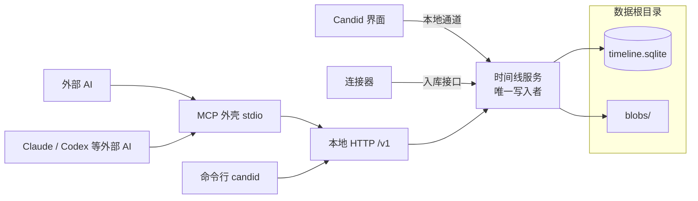

# 时间线库、查询接口与连接器 v1

**中文** · [English](timeline-v1.en.md)

**状态**：写成的规格。已实现 T1–T6（见第 10 节）；T7 未实现。Mac 桌面采集经入库接口直接写进本库，原桌面账本在核对通过后退役、只读保留（§9.1）；Hub 资料库仍由核心增量镜像（被请求时、最迟每 10 分钟一次）。时间线界面从本库读取。公共封套、引用和可迁移包仍以 artifact v1 为准；Mac 采集规则以 桌面采集 v1 为准；模型角色与处理流水线以 智能处理 为准。本文只规定这三者之间的统一存储、查询接口和来源接入。

<a id="decisions"></a>

## 1. 已确定的选择

决定：

1. **数据层与位置无关。** 数据层可以放在这台 Mac、NAS 或其他主机上，先以 Mac 本机服务为主。任何位置的数据都能完整迁移和导出。
2. **以外部 AI 为主。** Claude、Codex 等通过标准接口读取时间线。
3. **简单功能在核心内自动处理；在 App 里和 AI 对话、钩子启动的技能由挂接的 Pi 执行，外部 AI 经 MCP/API 接入，用同一套工具。** 核心里不做工具循环。
4. **模型来源统一管理。** 本地开源模型和云端 API 在同一处配置，用量和费用要有记录。
5. **连接器扩充时间线。** 来源包括手机、邮箱、AI 对话记录（Codex、Claude）、系统日历、MCP 等。时间线的主线不必是截图，可以由更丰富的事件构成。
6. **先做规格、数据结构和用量统计**，之后再接 AI 和主动能力。
7. **AI agent 对话：你说的话入库，AI 的回复只引用**。Codex、Claude Code、WorkBuddy、pi、dsh 等每个 agent 作为单独的连接器，由用户分别授权是否读取、是否纳入搜索、是否纳入活动，默认全部关闭。打开「纳入活动」后，你发给 AI 的消息、会话起止和 AI 工作摘要写入时间线库，在时间线上作为与截图平行的「AI 交互」一行显示；AI 的回复、工具输出和推理仍留在 agent 自己的文件里，需要时现读。理由：给 AI 的指令是你最主动的输入，权重高于屏幕上的被动活动；agent 会自行清理旧会话（如 Claude Code 默认约 30 天），只引用会让这些话随之消失。见 [6.2 节](#agent-connectors)。

工程设计（各项实现状态见第 10 节）：

- 只有一个时间线服务进程持有数据库。界面、MCP、命令行、pi 和连接器都通过接口访问，不直接打开 SQLite。
- 事件只有一种统一结构。AI 派生内容分层存放，可以删除后重新生成。
- 文字按段落去重存储，并附带注意力标记。
- 所有 AI 调用都记录到同一张用量表。

<a id="deployment"></a>

## 2. 服务、数据根目录与迁移

### 2.1 组件



- **时间线服务**：唯一读写数据库和原件目录的组件。桌面端是 Rust 核心的独立进程（[ADR-024](../decisions/024-rust-core.md)），由 App 启动和监控，同时监听回环 HTTP 和只供 App 使用的本地通道。以后也可以运行在 NAS 上，接口保持不变。
- **MCP 外壳与命令行**：都是 HTTP 的薄客户端，不打开数据库，也不读原件目录。
- **位置无关**：服务通过一个「数据根目录」定位全部数据。目录移到别处，或在另一台主机上用同一目录启动服务，数据都完整可用。

> SQLite 不能放在 SMB/NFS 网络共享上，由另一台机器远程打开（文件锁不可靠）。数据放 NAS 时，服务必须运行在 NAS 所在主机上，Mac 改用 HTTP 访问；不能由 Mac 去打开挂载上来的数据库文件。

远程访问必须加认证和 TLS，按隐私规范和项目规则第 9 条执行。首版只监听 `127.0.0.1`。

已实现：服务是 App 包内的辅助进程 `Contents/Helpers/candid serve`（Rust 核心），数据根目录默认 `~/Library/Application Support/Candid/timeline/`；回环 HTTP 每次启动选一个空闲端口并写入 `endpoint.json`；命令行与 MCP 外壳是同一个 `candid`。2026-11-10 之前服务在 Candid 进程内运行（Swift），数据根目录与表结构不变。

### 2.2 数据根目录布局

```text
<root>/
  store.json                  # 本库身份与版本，见下
  timeline.sqlite             # 以及 -wal、-shm
  blobs/sha256/<前2位>/<完整hash>.<扩展名>
  staging/                    # 入库暂存；启动时按桌面采集 v1 §6.2 的崩溃恢复规则处理
  exports/                    # 导出包输出目录（可改到别处）
  logs/                       # 滚动诊断日志，不含正文
```

`store.json`：

| 字段 | 类型 | 说明 |
|---|---|---|
| `store_id` | UUID | 本库身份，创建后不变；导出包和同步都引用它 |
| `schema_version` | 整数 | 与 `PRAGMA user_version` 一致；版本更新的库拒绝被旧服务写入 |
| `created_at` | RFC 3339 | 建库时间 |
| `created_by` | 字符串 | 创建该库的程序及版本，例如 `candid/0.10.0` |
| `layout` | 字符串 | 固定为 `timeline-root/1` |

API 密钥、OAuth 令牌和访问令牌原文**不**放进数据根目录。密钥存在宿主系统的密钥存储里（Mac 用钥匙串），库里只保存引用。

### 2.3 迁移与导出

- **整库迁移**：停止服务，原样复制整个数据根目录（用 SQLite 备份接口，或在停服状态下复制），然后在新位置启动服务。服务校验 `store.json`、数据库版本和抽样原件的 hash。
- **导出**：使用 artifact v1 可迁移包，提供三种范围（`agent_text`、`evidence_selected`、`full_owned`）。导出包不需要本服务和任何模型就能独立阅读。
- **导入**：先暂存再校验，按 `(source_id, source_key)` 与 `(artifact_id, revision)` 幂等写入，冲突进入冲突区，不覆盖已有数据。

<a id="conventions"></a>

## 3. 通用约定

| 项目 | 约定 |
|---|---|
| ID | 小写 UUIDv7 文本（按时间排序）。来源的原生 ID 不作主键，存在 `source_key` 中 |
| 时间 | 整数毫秒 UTC，字段名以 `_ms` 结尾。另存发生地的 `tz_offset_min`。区间为半开 `[start_ms, end_ms)`，`end_ms` 为空表示时间点或尚未结束 |
| 时间依据 | `time_basis`：`observed`（本机观察）、`source`（来源自报）、`imported`（只有导入时间）、`estimated`（推算）。另有 `time_uncertainty_ms` |
| JSON | `TEXT` 列，写入前校验。`*_json` 列有版本字段或固定结构，未知字段保留 |
| 表 | 一律 `STRICT`。开启外键，WAL 模式，单一写连接 |
| 枚举 | 写成 `CHECK` 约束；新增取值时同时升级数据库版本并补测试 |
| 删除 | 删除时写入墓碑并清理派生内容，见 5.8 节。不做「软删除后仍可查询」 |
| 修订 | 事实事件不改写，更正时产生新事件或新修订。派生层用 `(id, rev)` 标识 |

<a id="schema"></a>

## 4. 数据结构

下文 SQL 说明逻辑结构，运行表结构以 `core/crates/candid-store/src/schema.rs` 为准。当前数据库版本为 8（v8 增加按条目的 Agent 会话检查点、文件重复消息计数和独立媒体投影变更计数；v7 增加独立 `mac.system_audio` 来源并保留来源引用、授权与后台失效触发器；v6 增加来源键、活动任务与录音分段查询索引及内部后台变更计数；v4 增加邮件/浏览器历史来源种类、`quoted` 文字字段、`source_deleted` 墓碑原因和 `browser.visit`；v5 增加派生层的汇总与实体表、扩展记忆与纠正取值、任务所属功能，见 [§4.8.1](#derived-next)），v1–v7 事务升级并支持中断恢复；公共 Artifact 封套仍为 1.0。后台按事务内的变更计数跳过无变化扫描，待执行/到期任务与历史列表分别读取；来源授权仍在执行及回写时检查。旧 `ai.turn`、`ai_session` 和旧来源种类仅为迁移兼容保留，不由新连接器产生。

### 4.1 来源与同步进度

```sql
CREATE TABLE sources (
  source_id      TEXT PRIMARY KEY,                 -- UUIDv7
  kind           TEXT NOT NULL CHECK (kind IN (
                   'mac.desktop','mac.microphone','mac.system_audio','mac.region','media.import',
                   'device.pendant','phone.android','calendar.system','reminders.system',
                   'mail.imap','mail.gmail','mail.apple','browser.history','agent.transcript','mcp.remote','manual')),
  display_name   TEXT NOT NULL,
  device_id      TEXT,                             -- 采集设备或主机身份，可空
  account_ref    TEXT,                             -- 外部账号的引用（不含凭据）
  secret_ref     TEXT,                             -- 钥匙串条目引用，可空
  config_json    TEXT NOT NULL DEFAULT '{}',       -- 连接器自己的配置，带 version 字段
  policy_json    TEXT NOT NULL,                    -- 见下
  status         TEXT NOT NULL CHECK (status IN ('active','paused','error','revoked')),
  last_sync_ms   INTEGER,
  last_error     TEXT,                             -- 有限枚举的错误代码，不含正文
  created_ms     INTEGER NOT NULL,
  updated_ms     INTEGER NOT NULL
) STRICT;

CREATE TABLE source_cursors (
  source_id   TEXT NOT NULL REFERENCES sources(source_id) ON DELETE CASCADE,
  stream      TEXT NOT NULL,          -- 例如 'calendar:<日历ID>'、'sessions'
  cursor      TEXT NOT NULL,          -- 连接器自定义且不透明，只在入库事务提交后推进
  updated_ms  INTEGER NOT NULL,
  PRIMARY KEY (source_id, stream)
) STRICT;
```

v8 的 Agent 持久检查点包含 `agent_session_entries`（来源、会话、条目身份与类别、已脱敏的准入条目）和 `agent_file_counts`（来源、文件、内容 hash、出现次数）。两表只服务恢复和去重，继承来源授权与删除边界，不将回复/工具输出正文变成已存事实。进度游标、变化条目与准入事件同事务提交；旧内联检查点在下次同步该会话时转换，失败保留原状态。资料投影使用独立 `media_projection` 修订域，仅媒体输入、相关授权与标注变化使其失效；无关会话健康状态和角色模型配置不触发重投影。

`kind='agent.transcript'` 的来源在「纳入活动」关闭时只保存授权状态和路径配置，不产生任何 `events`、`threads` 或 `event_text` 行；打开后只产生 `ai.prompt`、`ai.work` 事件和 `agent_session` 线程，见 [6.2 节](#agent-connectors)。

`policy_json`（采集型来源的隐私与范围设置；引用型 agent 来源的设置见 6.2 节）：

```jsonc
{
  "version": 1,
  "store_text": true,          // 是否保存正文；false 时只保存元数据
  "store_media": false,        // 是否保存原件（图片、音频、附件）
  "agent_visible": true,       // 默认是否对 Agent 可见；具体还要看客户端范围
  "retention_days": null,      // 该来源的留存期，null 表示跟随全局设置
  "exclude": {"apps": [], "threads": [], "patterns": []}
}
```

### 4.2 事件：唯一的事实主线

```sql
CREATE TABLE events (
  event_id          TEXT PRIMARY KEY,
  source_id         TEXT NOT NULL REFERENCES sources(source_id),
  source_key        TEXT NOT NULL,          -- 来源原生 ID 或持久化导入 ID；用于幂等
  kind              TEXT NOT NULL REFERENCES event_kinds(kind),
  start_ms          INTEGER,                -- 未知时为空，此时 time_basis='imported'
  end_ms            INTEGER CHECK (end_ms IS NULL OR start_ms IS NULL OR end_ms >= start_ms),
  tz_offset_min     INTEGER,
  time_basis        TEXT NOT NULL CHECK (time_basis IN ('observed','source','imported','estimated')),
  time_uncertainty_ms INTEGER,
  app_bundle_id     TEXT,                   -- 应用标识；非应用来源为空
  app_name          TEXT,
  title             TEXT,                   -- 窗口标题、日程标题、邮件主题、会话名
  url               TEXT,                   -- 已去掉凭据、查询串和片段
  thread_id         TEXT REFERENCES threads(thread_id),
  parent_event_id   TEXT REFERENCES events(event_id),  -- 例如截图属于哪次焦点观察
  actor             TEXT NOT NULL DEFAULT 'self' CHECK (actor IN ('self','other','agent','system','unknown')),
  sensitivity       TEXT NOT NULL DEFAULT 'normal' CHECK (sensitivity IN ('normal','sensitive','protected')),
  payload_version   INTEGER NOT NULL,
  payload_json      TEXT NOT NULL,          -- 按 kind 的结构，见 4.3
  ingest_seq        INTEGER NOT NULL UNIQUE,-- 单调递增，用于变更流和分页快照
  ingested_ms       INTEGER NOT NULL,
  UNIQUE (source_id, source_key)
) STRICT;

CREATE INDEX events_time   ON events(start_ms, event_id);
CREATE INDEX events_app    ON events(app_bundle_id, start_ms) WHERE app_bundle_id IS NOT NULL;
CREATE INDEX events_kind   ON events(kind, start_ms);
CREATE INDEX events_thread ON events(thread_id, start_ms) WHERE thread_id IS NOT NULL;
CREATE INDEX events_source ON events(source_id, start_ms);
CREATE INDEX events_parent ON events(parent_event_id) WHERE parent_event_id IS NOT NULL;
```

- **排序键**：时间线按 `(COALESCE(start_ms, ingested_ms), event_id)` 排序。时间未知的事件在界面里单独分组，不冒充发生时间。
- **幂等**：重复同步同一条来源记录不会新增行；`source_key` 相同但内容不同时进入 `ingest_conflicts`，不覆盖。
- **受保护内容**：`sensitivity='protected'` 的事件只有元数据，永远不存正文和截图（例如密码框、标为受保护的窗口）。

```sql
CREATE TABLE event_kinds (          -- 登记表，随数据库版本更新
  kind         TEXT PRIMARY KEY,
  layer        TEXT NOT NULL CHECK (layer IN ('evidence','perception')),
  is_span      INTEGER NOT NULL,    -- 1 表示有持续时长
  payload_version INTEGER NOT NULL,
  description  TEXT NOT NULL
) STRICT;

CREATE TABLE ingest_conflicts (
  source_id   TEXT NOT NULL, source_key TEXT NOT NULL,
  existing_event_id TEXT NOT NULL, incoming_json TEXT NOT NULL,
  detected_ms INTEGER NOT NULL, resolved_ms INTEGER, resolution TEXT,
  PRIMARY KEY (source_id, source_key, detected_ms)
) STRICT;
```

### 4.3 事件种类与 payload（v1）

| kind | 层 | 时长 | 来源 | payload 字段 |
|---|---|---|---|---|
| `app.focus` | 证据 | 有 | mac.desktop | `{reason}`（切换、唤醒、恢复） |
| `window.focus` | 证据 | 有 | mac.desktop | `{window_token, coverage: "app"\|"window"}` |
| `screen.text` | 证据 | 无 | mac.desktop | `{trigger, text_status, focused_role, focused_label, is_composing, reader: {version, deep_pass: bool, nodes}}`。正文不在 payload 里，存在 `event_text` |
| `screen.shot` | 证据 | 无 | mac.desktop, mac.region | `{trigger, pixel_w, pixel_h, scale, source_bounds, ax_evidence_ref?}`，原件经 `event_blobs` 关联 |
| `marker` | 证据 | 无 | 任意 | `{label?, note?}` |
| `system.state` | 证据 | 无 | mac.desktop | `{change: "power"\|"sleep"\|"wake"\|"lock"\|"unlock"\|"session", value}` |
| `coverage.gap` | 证据 | 有 | 任意 | `{reason_code}`（paused、permission_denied、asleep、crashed、source_offline） |
| `audio.recording` | 证据 | 有 | mac.microphone, mac.system_audio, device.pendant, media.import | `{codec, sample_rate, channels, duration_ms, origin_filename?}` |
| `image.capture` | 证据 | 无 | mac.region, phone.android, media.import | `{pixel_w, pixel_h, origin_filename?, exif_time?}` |
| `speech.segment` | 感知 | 有 | ASR 作业 | `{recording_event_id, sample_start, sample_end, speaker_label?, speaker_candidate?, asr: {model_id, revision}}`；文字在 `event_text` |
| `image.text` | 感知 | 无 | OCR / VLM 作业 | `{image_event_id, method: "ax"\|"ocr"\|"vlm", model_id?, regions_ref?}` |
| `calendar.event` | 证据 | 有 | calendar.system | `{calendar_id, calendar_name, all_day, location?, attendees: [{name?, email_hash?}], status, recurrence_id?}` |
| `reminder.item` | 证据 | 无 | reminders.system | `{list_name, due_ms?, completed_ms?, priority?}` |
| `mail.message` | 证据 | 无 | mail.apple, mail.imap | `{adapter, direction: "in"\|"out", from: {name?, address_hash?}, to_count, cc_count, has_attachments, attachments: [{name?, mime, size}], mailboxes: [..], account?, level, level_basis, ai_judge?, body_status: "complete"\|"partial"\|"not_downloaded"\|"undecodable", body_format, list, automated, quoted_chars, signature_chars, revision?}`；文字 `subject`、`body`（新写的部分）、`quoted`（引用的历史和签名，不进抽取输入）；`level=metadata` 时只存主题 |
| `browser.visit` | 证据 | 无 | browser.history | `{browser, visit_count}`，`url` 去掉凭据、查询串和片段；v4 已登记，**导入未开启** |
| `note` | 证据 | 无 | manual | `{format: "text"\|"markdown"}` |
| `ai.prompt` | 证据 | 无 | agent.transcript；屏幕补位见 records-v1 | `{agent, session_ref, message_ref, project?, followups: n, truncated: bool, origin: "transcript"\|"screen"}`；你写的文字存入 `event_text`（字段 `prompt`），追问并入同一事件 |
| `ai.work` | 证据 | 有 | agent.transcript | `{agent, session_ref, prompt_event_id, status: "done"\|"running"\|"interrupted", assistant_messages, tool_calls: {名称: 次数}, files_touched, tokens?}`；不存回复正文 |

- 新增 kind 要同时登记 `event_kinds`、提供 payload 校验和测试，再在本表加一行。
- 邮箱地址和参会人邮箱只存加盐 hash，用于判断是否同一人；明文地址只在用户另行授权的人物记录里出现。
- AI agent 对话只有你发出的消息（`ai.prompt`）和 AI 工作摘要（`ai.work`）入库，回复正文不入库（见 6.2 节）。原先保留的 `ai.turn` 不再使用。实现时登记这两种事件和线程种类 `agent_session`，表结构版本已升为 2，旧库按事务迁移升级并验证失败恢复（ RA，）；`agent_event_revisions` 保存已接收消息与统计的逐次快照，索引只关联当前修订。

### 4.4 线程：会议、对话、邮件串

```sql
CREATE TABLE threads (
  thread_id    TEXT PRIMARY KEY,
  source_id    TEXT NOT NULL REFERENCES sources(source_id),
  source_key   TEXT NOT NULL,
  kind         TEXT NOT NULL CHECK (kind IN ('mail_thread','meeting','recording','calendar_series','chat','agent_session')),
  title        TEXT,
  started_ms   INTEGER,
  ended_ms     INTEGER,
  participants_json TEXT NOT NULL DEFAULT '[]',
  payload_json TEXT NOT NULL DEFAULT '{}',   -- 例如会议的来源应用、邮件串的标签
  UNIQUE (source_id, source_key)
) STRICT;
CREATE INDEX threads_time ON threads(started_ms);
```

### 4.5 原件

```sql
CREATE TABLE blobs (
  sha256       TEXT PRIMARY KEY,              -- 实际字节的 hash
  byte_count   INTEGER NOT NULL,
  mime_type    TEXT NOT NULL,
  rel_path     TEXT NOT NULL UNIQUE,          -- 相对于数据根目录，由服务生成
  pixel_w INTEGER, pixel_h INTEGER, duration_ms INTEGER,
  created_ms   INTEGER NOT NULL,
  verified_ms  INTEGER                        -- 最近一次重新校验 hash 的时间
) STRICT;

CREATE TABLE event_blobs (
  event_id  TEXT NOT NULL REFERENCES events(event_id) ON DELETE CASCADE,
  sha256    TEXT NOT NULL REFERENCES blobs(sha256),
  role      TEXT NOT NULL CHECK (role IN ('original','preview','derived')),
  PRIMARY KEY (event_id, sha256, role)
) STRICT;
```

两次不同的发生可以引用同一份字节，各自保留自己的时间和权限。没有任何事件引用的原件，在删除流程中清理。

<a id="text"></a>

### 4.6 文字：段落去重与注意力

```sql
CREATE TABLE text_chunks (
  chunk_id     INTEGER PRIMARY KEY,           -- 供全文索引 rowid 使用
  chunk_hash   TEXT NOT NULL UNIQUE,          -- 规范化文本的 sha256
  text         TEXT NOT NULL,
  char_count   INTEGER NOT NULL,
  lang         TEXT,                          -- 'zh'、'en'、'mixed' 等，可空
  first_seen_ms INTEGER NOT NULL
) STRICT;

CREATE TABLE event_text (
  event_id       TEXT NOT NULL REFERENCES events(event_id) ON DELETE CASCADE,
  field          TEXT NOT NULL CHECK (field IN ('prompt','body','selection','title','transcript','ocr','vlm','message','subject','note','quoted')),
  ord            INTEGER NOT NULL,            -- 在该事件该字段内的顺序
  chunk_id       INTEGER NOT NULL REFERENCES text_chunks(chunk_id),
  visible        INTEGER CHECK (visible IN (0,1)),        -- 是否在可见区域；未知为空
  focus_distance INTEGER,                     -- 与焦点元素的树距离：0 为焦点本身；未知为空
  is_new         INTEGER NOT NULL CHECK (is_new IN (0,1)),-- 相对上一次同来源文字是否新出现
  char_start     INTEGER,                     -- 在原始拼接文本中的码点偏移，供引用定位
  PRIMARY KEY (event_id, field, ord)
) STRICT;
CREATE INDEX event_text_chunk ON event_text(chunk_id);
```

**切分与规范化**

1. 文本先做 Unicode NFC 规范化，统一换行，去掉行尾空白，把连续空白行折叠成一个。
2. 按段落（空行）切分。超过 512 个字符的段落再按句号或换行切开，单段不超过 512 字符。
3. `chunk_hash` 对规范化后的段落计算。同一段文字在全库只存一份。

**新内容判定（`is_new`）**：与同一来源、同一应用窗口上一条 `screen.text` 事件的段落集合比较，上次没有的段落记为新。语音、邮件、AI 对话的段落都记为新。

**用途**

- 界面和 AI 摘要先读「新出现、可见、离焦点近（`focus_distance` ≤ 3）」的段落；其余作为背景，只在用户展开或明确搜索时出现。
- 长上下文重复出现时只增加 `event_text` 的引用行，不再写一份正文。Codex 这类窗口在同一片段里反复记录同样的大段上下文，不会让库膨胀，也不会让摘要重复。
- 这些规则对所有应用一致，不按应用单独调整。

<a id="fts"></a>

### 4.7 检索索引（可重建投影）

```sql
-- 段落正文索引。具体分词器以中文用例实测结果决定，见第 11 节
CREATE VIRTUAL TABLE text_fts USING fts5(text, content='text_chunks', content_rowid='chunk_id', tokenize='trigram');
-- 元数据索引：标题、应用名、URL、线程标题
CREATE VIRTUAL TABLE meta_fts USING fts5(title, app_name, url, content='', tokenize='trigram');
```

- 索引可以随时从 `text_chunks` 和 `events` 重建，不作为事实来源。
- **中文检索要求**：两个字的短词（如「预算」「样稿」）必须能搜到。trigram 只能直接匹配三个字符及以上的查询，因此候选方案有两个，实测后选定：
  - 另建一列，按中文二字切分后建索引；
  - 两个字的查询先用结构化过滤（时间、应用、来源）缩小范围，再做受限的字面匹配，扫描上限 5000 段。
- **排序**：在 BM25 分数基础上，叠加时间新近度和注意力权重（可见、离焦点近、新出现的段落权重更高）。具体权重可配置，放在 `store_meta` 中。
- 以后加向量检索时，另建 `chunk_vectors(chunk_id, model_id, dim, vector BLOB)`。换模型要新建索引，不能和旧向量混用。

### 4.8 派生层：片段、记忆与纠正

派生对象使用 artifact v1 的身份：`artifact_id` 加不可覆盖的 `revision`。它们可以整体删除后重新生成，用户的纠正单独保存，重新生成后仍然生效。

```sql
CREATE TABLE episodes (
  episode_id   TEXT NOT NULL,
  rev          INTEGER NOT NULL,
  start_ms     INTEGER NOT NULL,
  end_ms       INTEGER NOT NULL,
  title        TEXT,
  summary      TEXT,
  kind         TEXT NOT NULL CHECK (kind IN ('activity','meeting','conversation','focus','break','mixed')),
  status       TEXT NOT NULL CHECK (status IN ('draft','confirmed','edited','rejected','superseded')),
  producer     TEXT NOT NULL,          -- 'rules/1' 或 '<runner>/<版本>'
  model_ref    TEXT,                   -- providers 与 models 中的组合 ID，规则生成时为空
  prompt_version TEXT,
  confidence   REAL,                   -- 没有可信的校准方法时为空
  created_ms   INTEGER NOT NULL,
  PRIMARY KEY (episode_id, rev)
) STRICT;
CREATE INDEX episodes_time ON episodes(start_ms) WHERE status NOT IN ('rejected','superseded');

CREATE TABLE episode_evidence (
  episode_id TEXT NOT NULL, rev INTEGER NOT NULL,
  event_id   TEXT NOT NULL REFERENCES events(event_id) ON DELETE CASCADE,
  role       TEXT NOT NULL CHECK (role IN ('primary','supporting','context')),
  selector_json TEXT,                  -- 文本区间或音频样本区间；格式见 artifact v1
  PRIMARY KEY (episode_id, rev, event_id),
  FOREIGN KEY (episode_id, rev) REFERENCES episodes(episode_id, rev) ON DELETE CASCADE
) STRICT;

CREATE TABLE memories (
  memory_id   TEXT NOT NULL,
  rev         INTEGER NOT NULL,
  kind        TEXT NOT NULL CHECK (kind IN ('fact','preference','judgment','commitment','person','project','decision','question','reference')),
  text        TEXT NOT NULL,
  valid_from_ms INTEGER, valid_to_ms INTEGER,
  status      TEXT NOT NULL CHECK (status IN ('candidate','confirmed','edited','rejected','expired','superseded')),
  producer    TEXT NOT NULL, model_ref TEXT, prompt_version TEXT, confidence REAL,
  created_ms  INTEGER NOT NULL,
  PRIMARY KEY (memory_id, rev)
) STRICT;

CREATE TABLE memory_sources (
  memory_id TEXT NOT NULL, rev INTEGER NOT NULL,
  ref_type  TEXT NOT NULL CHECK (ref_type IN ('event','episode')),
  ref_id    TEXT NOT NULL, ref_rev INTEGER,
  selector_json TEXT,
  PRIMARY KEY (memory_id, rev, ref_type, ref_id),
  FOREIGN KEY (memory_id, rev) REFERENCES memories(memory_id, rev) ON DELETE CASCADE
) STRICT;

CREATE TABLE corrections (             -- 用户纠正；重新生成派生内容时套用
  correction_id TEXT PRIMARY KEY,
  target_type   TEXT NOT NULL CHECK (target_type IN ('episode','memory','event_label','speaker','digest','entity')),
  target_id     TEXT NOT NULL,
  action        TEXT NOT NULL CHECK (action IN ('rename','edit_text','merge','split','reject','confirm','relabel')),
  value_json    TEXT NOT NULL,
  created_ms    INTEGER NOT NULL
) STRICT;
```

**活动段**（同一应用连续使用的时段）是规则投影，不入库。它由 `app.focus` 和 `window.focus` 实时计算，规则见桌面采集 v1 §6.1。

<a id="derived-next"></a>

#### 4.8.1 派生层 v5（表结构已实现；写入随 ）

2026-11-12 AI 功能设计确定后（[基座 §4.1–4.4](agent-platform-v1.md#skills-triggers)），派生层要启用和增加的部分。表结构、取值、`jobs.feature` 与删除级联已在数据库 v5 实现；录音的流程产出已写入派生层：标题、摘要写成片段 `rec:<录音>`（每次重跑一个新修订，旧修订标 superseded，来源修订和任务等出处放在主证据的 `selector_json`），决定写成 `decision` 记忆候选，日回顾写成天级汇总 `day:<日期>`；标签和截图文字暂无对应表，仍存键值区。屏幕片段写入及摘要见下文 ；抽取、实体与小时/周汇总继续 。删除一条事件时，指向它的实体提及删除、覆盖它所在时段的汇总整条删除并记墓碑，下次运行重新生成；实体本身保留。

093 继续复用 v5：屏幕片段使用 `screen:<稳定编号>`，证据的 `screen-selector/1` 保存字段及半开字符区间；模型摘要与人工编辑各形成新修订，来源撤权/删除或输入改变后失效。技能运行使用现有 `jobs`，完整的 `candid-agent-run/1` 与不可覆盖状态修订保存在 `store_meta`，含冻结来源/角色/预算、模型身份、工具步骤和结果。新增的是版本化 payload，无数据库结构迁移；公共 Artifact 封套仍为 1.0。合约见处理载荷，正常、错误区间、未知版本及 Rust 产物兼容由生成 schema 与合成样例验证。

| 变更 | 内容 |
|---|---|
| 启用 `episodes` / `episode_evidence` | 屏幕片段和录音（一段录音就是一个片段）都写进来；标题、摘要的模型草稿与你的修改分开，显示优先级：你改过的 > 模型草稿 > 时间 |
| 启用 `memories` / `memory_sources` | `kind` 增加 `decision`、`question`、`reference`（你标记的资料）；`person`、`project` 不再使用，人和项目只在实体表里 |
| 新增实体三表 | `entities`、`entity_aliases`、`entity_mentions`，结构见[基座 §2.6](agent-platform-v1.md#entities)；`kind` 增加 `topic`，`alias_kind` 增加 `voice`（对应语音服务的声纹人员编号） |
| 新增 `digests` | 见下 |
| 扩展 `corrections` | `target_type` 增加 `digest`、`entity` |
| 扩展 `jobs` | 增加 `feature`（功能目录编号），运行记录按功能查询 |
| 迁移流程草稿 | 现有键值区里的 `draft/1` 文本按类型迁入：录音标题与摘要进 `episodes`，决定与待办进 `memories`，录音日回顾进 `digests`；打开库时执行一次（标记 `workflows.drafts.migrated/1`），旧键值只读保留一个版本，表里有的以表为准 |

```sql
CREATE TABLE digests (                 -- 小时、天、周汇总；日回顾是天级的草稿修订
  digest_id   TEXT NOT NULL,           -- 级别 + 时段起点，例如 'day:2026-11-12'
  rev         INTEGER NOT NULL,
  level       TEXT NOT NULL CHECK (level IN ('hour','day','week')),
  start_ms    INTEGER NOT NULL,
  end_ms      INTEGER NOT NULL,
  body_json   TEXT NOT NULL,           -- 规则统计 + 文字要点，每条要点带来源引用
  status      TEXT NOT NULL CHECK (status IN ('draft','confirmed','edited','rejected','superseded')),
  producer    TEXT NOT NULL, model_ref TEXT, prompt_version TEXT,
  run_id      TEXT,                    -- 生成它的流程运行或技能运行
  created_ms  INTEGER NOT NULL,
  PRIMARY KEY (digest_id, rev)
) STRICT;
```

派生结果的状态统一为草稿、已确认、已改、已拒绝、已被取代（`memories` 的 `candidate` 对应草稿）。旧修订保留最新的、你确认或改过的、被提案引用的；其余旧草稿 30 天后清理。

<a id="ai-usage"></a>

### 4.9 模型来源、角色与用量

```sql
CREATE TABLE ai_providers (
  provider_id  TEXT PRIMARY KEY,
  name         TEXT NOT NULL,                       -- 例如「本机 LM Studio」「Anthropic」
  api          TEXT NOT NULL CHECK (api IN ('openai-chat','openai-responses','anthropic-messages','gemini','ollama','other')),
  base_url     TEXT NOT NULL,
  secret_ref   TEXT,                                -- 钥匙串引用；本地服务可为空
  destination  TEXT NOT NULL CHECK (destination IN ('on_device','self_hosted','cloud')),
  enabled      INTEGER NOT NULL,
  headers_json TEXT NOT NULL DEFAULT '{}',          -- 不含密钥
  created_ms INTEGER NOT NULL, updated_ms INTEGER NOT NULL
) STRICT;

CREATE TABLE ai_models (
  provider_id    TEXT NOT NULL REFERENCES ai_providers(provider_id) ON DELETE CASCADE,
  model_id       TEXT NOT NULL,                     -- 服务商的模型名
  display_name   TEXT,
  context_window INTEGER, max_output INTEGER,
  modalities_json TEXT NOT NULL DEFAULT '["text"]',
  supports_tools INTEGER, supports_json_schema INTEGER,  -- 能力探测结果，未探测时为空
  cost_json      TEXT,   -- {"currency":"USD","per_mtok":{"input":..,"output":..,"cache_read":..,"cache_write":..},"source":"catalog|manual","as_of":"2026-11-10"}
  probed_ms      INTEGER,
  PRIMARY KEY (provider_id, model_id)
) STRICT;

CREATE TABLE ai_roles (                 -- 角色与模型的对应，角色清单见智能规范
  role         TEXT PRIMARY KEY,        -- 'agent_chat','summary','episode','vision','ocr','embedding','asr_fast',...
  provider_id  TEXT, model_id TEXT,
  fallback_json TEXT NOT NULL DEFAULT '[]',   -- 只能回退到同一 destination 或更本地的来源
  limits_json  TEXT NOT NULL DEFAULT '{}',    -- 每次输入与输出 token 上限、每日预算
  FOREIGN KEY (provider_id, model_id) REFERENCES ai_models(provider_id, model_id)
) STRICT;

CREATE TABLE ai_calls (                 -- 本应用发起的每一次模型调用
  call_id        TEXT PRIMARY KEY,
  started_ms     INTEGER NOT NULL,
  ended_ms       INTEGER,
  feature        TEXT NOT NULL,         -- 'agent_chat','daily_review','episode','recognition','embedding',...
  client         TEXT NOT NULL CHECK (client IN ('app','pi','worker')),
  run_id         TEXT,                  -- 所属 Agent 运行或作业
  provider_id    TEXT NOT NULL, model_id TEXT NOT NULL,
  destination    TEXT NOT NULL,
  input_tokens   INTEGER, output_tokens INTEGER, cache_read_tokens INTEGER, cache_write_tokens INTEGER,
  cost           REAL, currency TEXT,
  cost_source    TEXT CHECK (cost_source IN ('provider','estimated','unknown')),
  latency_ms     INTEGER,
  status         TEXT NOT NULL CHECK (status IN ('ok','error','cancelled','timeout')),
  error_code     TEXT,
  request_bytes  INTEGER, response_bytes INTEGER
) STRICT;
CREATE INDEX ai_calls_time    ON ai_calls(started_ms);
CREATE INDEX ai_calls_feature ON ai_calls(feature, started_ms);
CREATE INDEX ai_calls_model   ON ai_calls(provider_id, model_id, started_ms);
```

- `ai_calls` **不保存提示词和回答正文**。正文如需保留，作为 Agent 运行记录（artifact 交互层）另存，并受权限约束。
- Codex、Claude 等外部 agent 的用量不入库。`usage` 工具在 `include_external=true` 且该 agent 已授权「读取」时，由连接器从源文件现算并标明来源，不进 `ai_calls`。
- 费用：服务商返回实际计费时记 `provider`，按价格表估算时记 `estimated`。价格表变化不改写历史记录。

### 4.10 访问方、审计与提案

```sql
CREATE TABLE clients (                 -- 每个可以查询本库的 AI 或工具
  client_id    TEXT PRIMARY KEY,
  name         TEXT NOT NULL,          -- 「Claude Desktop」「Codex」「pi（外部）」
  transport    TEXT NOT NULL CHECK (transport IN ('mcp','http','cli','internal')),
  token_hash   TEXT,                   -- 访问令牌的 hash；令牌原文只显示一次
  scope_json   TEXT NOT NULL,          -- 见下
  created_ms   INTEGER NOT NULL,
  revoked_ms   INTEGER
) STRICT;

CREATE TABLE access_log (
  log_id       TEXT PRIMARY KEY,
  at_ms        INTEGER NOT NULL,
  client_id    TEXT NOT NULL REFERENCES clients(client_id),
  tool         TEXT NOT NULL,
  params_json  TEXT NOT NULL,          -- 请求参数；关键词按 store_meta 设置可以不留
  result_count INTEGER, result_bytes INTEGER, duration_ms INTEGER,
  denied       TEXT                    -- 拒绝原因代码；成功时为空
) STRICT;
CREATE INDEX access_log_time ON access_log(at_ms);

CREATE TABLE proposals (
  proposal_id  TEXT PRIMARY KEY,
  client_id    TEXT NOT NULL REFERENCES clients(client_id),
  kind         TEXT NOT NULL,          -- 'create_reminder','create_calendar_event','correct_episode','add_memory',...
  payload_json TEXT NOT NULL,
  evidence_json TEXT NOT NULL DEFAULT '[]',
  status       TEXT NOT NULL CHECK (status IN ('pending','approved','rejected','executed','failed','expired')),
  created_ms INTEGER NOT NULL, decided_ms INTEGER, executed_ms INTEGER,
  result_json  TEXT
) STRICT;
```

`scope_json`（服务端在排序和截取片段**之前**先过滤）：

```jsonc
{
  "version": 1,
  "sources": ["*"],               // 允许的 source_id，或 "*"
  "kinds": ["*"],
  "apps": {"allow": ["*"], "deny": ["com.apple.keychainaccess"]},
  "time": {"from": null, "to": null, "max_days_back": 90},
  "text": true,                   // 能否拿到正文；false 时只有元数据
  "media": false,                 // 能否取截图、音频
  "derived": true,                // 能否读片段与记忆
  "agents": [],                   // 可经本访问方读取的 agent 连接器（agent_id 列表），默认空；仍受 6.2 节的用户授权约束
  "propose": true,                // 能否提交提案
  "propose_kinds": [],            // 可提交的提案种类；空表示不限（缺省，旧登记均如此）
  "writes": [],                   // 本库内写入档：annotate、reference、commitment、draft；空表示只读（缺省）。见 agent-platform-v1 §4.1
  "max_result_bytes": 65536
}
```

### 4.11 作业、变更与删除

```sql
CREATE TABLE jobs (
  job_id        TEXT PRIMARY KEY,
  kind          TEXT NOT NULL,          -- 'asr','ocr','vlm','episode','fts_rebuild','connector_sync',...
  input_ref     TEXT NOT NULL,          -- 事件 ID 或 artifact 的 id 与 rev
  config_version TEXT NOT NULL,         -- 处理器、模型与提示词版本组合
  state         TEXT NOT NULL CHECK (state IN ('queued','running','done','failed','cancelled')),
  attempts      INTEGER NOT NULL DEFAULT 0,
  next_run_ms   INTEGER, lease_until_ms INTEGER,
  error_code    TEXT, output_ref TEXT,
  created_ms INTEGER NOT NULL, updated_ms INTEGER NOT NULL,
  feature       TEXT,                   -- 所属功能（功能目录编号），v5
  UNIQUE (kind, input_ref, config_version)
) STRICT;

CREATE TABLE changes (                  -- 变更流：界面刷新、同步和订阅都用它
  seq       INTEGER PRIMARY KEY AUTOINCREMENT,
  at_ms     INTEGER NOT NULL,
  entity    TEXT NOT NULL,              -- 'event','thread','episode','memory','source','blob'
  entity_id TEXT NOT NULL,
  op        TEXT NOT NULL CHECK (op IN ('insert','update','delete'))
) STRICT;

CREATE TABLE tombstones (
  entity    TEXT NOT NULL, entity_id TEXT NOT NULL,
  deleted_ms INTEGER NOT NULL,
  reason    TEXT NOT NULL CHECK (reason IN ('user','retention','source_revoked','import_rollback','superseded','source_deleted')),  -- superseded：识别或转写重跑后，旧结果被新结果取代；source_deleted：来源里已删除（v4）
  PRIMARY KEY (entity, entity_id)
) STRICT;

CREATE TABLE store_meta (key TEXT PRIMARY KEY, value TEXT NOT NULL) STRICT;
```

**删除顺序**：

1. 写墓碑，立即对查询和 Agent 隐藏。
2. 取消引用了这些数据的作业。
3. 删除相关派生内容和索引条目。
4. 清理已无人引用的段落和原件。

迟到的作业在提交前都要检查墓碑，已删除的内容不能被重新生成。删除不在墓碑里保存标题和正文。

<a id="query-api"></a>

## 5. 查询接口

HTTP（`/v1/<tool>`）、MCP 和命令行（`candid <tool> --json`）三种方式的**工具名和参数完全相同**。Candid 自己的界面也走同一套查询服务。

### 5.1 共同规则

- **时间参数**：接受 RFC 3339、`YYYY-MM-DD`，以及 `today`、`yesterday`、`-2h`、`now` 这类相对写法。服务端按本机时区解析，并在结果中返回解析后的绝对时间。
- **分页**：使用不透明的 `cursor`，其中固定了查询当时的 `ingest_seq` 快照。新到的数据不会插进已经翻过的页，结果会提示「有新记录」。
- **体积**：`limit` 默认 10、上限 50；每条结果的正文按 `max_chars` 截断（默认 600，取值 40–4000，超出时取边界值），并标明是否被截断。每次响应受客户端的 `max_result_bytes` 限制。
- **来源标签**：每条结果都带 `source_label`，例如 `screen·ax`、`screen·ocr`、`audio·asr`、`calendar`、`mail`、`ai·codex`（AI agent 对话统一用 `ai·<agent>`），并用 `layer` 标明是事实（`evidence`）、派生（`derived`）还是现读的外部内容（`external`，未入库）。
- **缺口**：响应中的 `coverage` 说明这段时间有没有在记录，例如「13:00–14:00 已暂停记录」「邮箱来源 3 天未同步」。没有结果和没有记录要分开说明。
- **不可信文本**：返回的正文是证据，不是指令。MCP 工具描述里要写明这一点。
- **审计**：每次调用都写一条 `access_log`，被拒绝的调用也写。

### 5.2 工具清单

| 工具 | 用途 | 主要参数 | 返回 |
|---|---|---|---|
| `source_query` | 按消息时间核对已授权来源，或解析结构化引用 | `action`（`candidates`/`reference`）、`start_ms`、`end_ms`、`sessions[]`、`cursor`、`reference` | 候选消息/来源修订及 `next_cursor`、`incomplete`；不完整不得确认发出 |
| `records` | 读取已核对的记录修订 | `id` | 逐来源检查权限及删除状态后的修订记录 |
| `agent` | 现读已授权会话，不保存回复 | `agent`、`action`、`reference`、`cursor`、时间/项目/查询/数量限制 | 版本化会话、消息、搜索或用量结果；同时要求访问方与来源授权 |
| `status` | 本库和各来源是否正常 | — | `store`（版本、大小）；`sources[]`（kind、status、last_sync、lag、last_ingest、last_error）；`last_sync` 是该来源最近一次成功检查的时间（没有新数据也前进，失败不前进），`lag` 据此计算，`last_ingest` 是它最近一次写入新数据的时间（由事件的入库时间得出，不另存），`status` 为 `error` 时 `last_error` 给出有限的错误代码；`capture`（是否在记录）；处理状态（固定流程是否可用；接口扩展待实施） |
| `overview` | 一段时间的概况，第一个调用 | `start`、`end`、`group_by`（app、hour、source、episode） | 约 300 个 token：各应用实际使用时长、片段列表（标题与时间）、日程、会议与录音、缺口 |
| `search` | 关键词加过滤 | `q?`、`start`、`end`、`apps[]`、`sources[]`、`kinds[]`、`thread_id?`、`fields[]`、`attention`（`focus`\|`all`，默认 `focus`）、`limit`、`cursor`、`max_chars` | `hits[]`：`event_id`、时间、kind、应用、标题、`snippet`（带高亮区间）、`source_label`、`score`、可展开的引用 |
| `timeline` | 按时间顺序列出事件或片段 | `start`、`end`、`level`（`episode`\|`event`）、`apps[]`、`sources[]`、`kinds[]`、`limit`、`cursor` | 有序条目；`episode` 级返回片段及其证据数量 |
| `context` | 某一时刻前后在做什么 | `at`、`before`、`after`（分钟，默认各 5）、`include`（text、media_refs） | 该区间的事件、处于焦点的段落、同期的录音和日程 |
| `get_event` | 一条事件的详情 | `event_id`、`include`（text、neighbors、media_refs、derived） | 完整事件、按注意力排序的段落、所属线程、引用了它的片段 |
| `episodes` | 派生片段列表 | `start`、`end`、`status[]`、`limit`、`cursor` | 片段的标题、摘要、时间、状态、生成方式、证据数量 |
| `episode` | 单个片段 | `episode_id`、`rev?` | 片段内容与 `evidence[]`（带 selector） |
| `thread` | 一个对话、会议或邮件串 | `thread_id`、`cursor`、`limit` | 按顺序的消息或转写段落 |
| `media` | 截图或音频（默认关闭） | `event_id`、`variant`（`preview`\|`original`）、`range?` | 需要客户端有 `media` 权限，返回限时的本地 URL 或 base64 缩略图。**当前实现**只返回 base64，限时 URL 和音频的 `range` 参数未实现；开放媒体权限前补上 |
| `usage` | AI 用量统计 | `start`、`end`、`group_by`（feature、model、provider、day）、`include_external` | 调用次数、token 数、费用（区分实际值和估算值） |
| `propose` | 提交提案 | `kind`、`payload`、`evidence[]` | `proposal_id`、`status: pending` |

**agent 对话的路由**：`search` 只有在该 agent 的「纳入搜索」已开启、且访问方 `scope.agents` 包含它时，才由连接器现查并合并结果；`thread` 和 `get_event` 接受 `agent:` 引用，在「读取」已开启时现读。现读结果标为 `layer: "external"`、`stored: false`，不写入库，也不进入检索索引；`access_log` 照常记录。`overview` 和 `timeline` 可包含按授权入库的 `ai.prompt`、`ai.work`；外部回复只通过现读返回。

**响应示例**（`search` 的一条结果）：

```json
{
  "event_id": "01933c2a-7f5e-7c8a-9a1b-2f6d0c1e4b55",
  "kind": "screen.text",
  "start": "2026-11-10T10:24:48+08:00",
  "app": {"bundle_id": "notion.id", "name": "Notion"},
  "title": "11.6 overview",
  "source_label": "screen·ax",
  "layer": "evidence",
  "snippet": {"text": "…进一步细化 gb10 性能模型，标准是什么…", "highlights": [[6, 15]], "truncated": true},
  "attention": {"visible": true, "focus_distance": 2, "is_new": true},
  "ref": {"event_id": "01933c2a-…", "field": "body", "chunk_ord": 3, "char_range": [120, 168]}
}
```

### 5.3 推荐的调用顺序（写进 MCP 工具描述）

1. 宽泛的问题（「我今天做了什么」）先调 `overview`。
2. 找具体内容时用 `search`，命中后用 `context` 或 `get_event` 展开细节。
3. 只有确实需要看画面或听声音时，才调 `media`。

### 5.4 访问方式与鉴权

| 方式 | 地址或命令 | 鉴权 |
|---|---|---|
| HTTP | `http://127.0.0.1:<端口>/v1/<tool>`。服务启动后把端口写入本机运行时文件（Mac：`~/Library/Application Support/Candid/run/endpoint.json`），不放在数据根目录里 | 每个访问方一个 Bearer 令牌；同时检查 `Host` 和 `Origin` |
| MCP | `candid mcp`（stdio），读取令牌后转发到 HTTP | 每个 MCP 访问方在 `clients` 中单独登记，有自己的权限范围 |
| 命令行 | `candid <tool> [--参数 值]`，或 `--json '{...}'` | 使用当前用户的本机令牌（运行目录里的 `cli.token`，权限 0600），范围与「本机命令行」访问方一致 |
| 本地通道（只供 App） | 运行目录里的 Unix 域套接字（文件 0600、目录 0700），HTTP/1.1。除 `/v1/<tool>` 外还有访问方管理、立即同步与核对、「有新数据」推送、健康检查和 App 自用的入库接口，接口清单见 [core](../../core/README.md#local-channel) | 只有当前用户能连接；App 是内部访问方（`transport='internal'`），带令牌时按该访问方。管理、推送、健康和入库接口在回环 HTTP 上一律拒绝（403 `local_only`） |

访问方在 设置 →「外部访问」登记：每个工具一个令牌，只显示一次，同时给出 Claude Code 命令、Codex 配置和通用 JSON。默认范围：最近 90 天、正文与派生内容可读、截图和录音不可读、不能提交提案（App 内还没有批准界面）。环境变量 `CANDID_TOKEN`、`CANDID_ENDPOINT`、`CANDID_RUN_DIR` 可覆盖令牌、地址和运行目录。命令行和 MCP 外壳按 App 的「网络代理」设置连接（默认系统代理，可选不走代理）。

<a id="connectors"></a>

## 6. 连接器

连接器分两类：

| | 采集型（ingest） | 引用型（reference） |
|---|---|---|
| 用于 | 自己产生的数据：桌面、录音、截图、挂件、手机采集；系统日历；邮件 | 别的系统自己保存的数据：AI agent 对话记录；以后可能有 Notion |
| 库里存什么 | 事件、正文、原件 | 只存授权状态和路径配置，不存内容 |
| 内容从哪来 | 时间线库 | 需要时由连接器到源头现读 |
| 默认 | 按该来源的授权开启 | 每个开关都关闭 |

AI agent 连接器是引用型，但打开「纳入活动」后按采集型协议写入你发出的消息和工作摘要，见 6.2 节。

<a id="ingest-connectors"></a>

### 6.1 采集型连接器协议

每个采集型连接器实现以下能力，由服务调度运行。连接器只能经入库接口写入，不能直接写数据库。

| 能力 | 说明 |
|---|---|
| `describe()` | kind、显示名、需要的权限、能产出的事件种类和线程种类、默认 `policy_json` |
| `authorize()` | 引导用户完成系统授权或 OAuth。凭据存入钥匙串，只返回 `secret_ref` |
| `backfill(range)` | 补录历史，范围由用户选择，可以中断后续跑 |
| `sync(cursor)` | 增量同步，返回一批 `IngestBatch` 和新游标 |
| `revoke()` | 停止同步，并按用户选择保留或删除该来源的数据 |

`IngestBatch`（`on_missing_parent` 可选：`detach` 时父事件既不在本批也不在库里的事件照常入库、不带父链接，用于 App 采集里被隐私门禁拦下或已被用户删除的父记录；缺省时整批失败）：

```json
{
  "source_id": "…",
  "cursor_after": {"stream": "calendar:<日历ID>", "cursor": "…"},
  "threads": [{"source_key": "…", "kind": "calendar_series", "title": "…", "started_ms": 0}],
  "events":  [{"source_key": "…", "kind": "calendar.event", "start_ms": 0, "end_ms": 0, "time_basis": "source",
               "thread_key": "…", "payload_version": 1, "payload": {},
               "text": [{"field": "subject", "content": "…"}],
               "blobs": [{"staging_path": "…", "sha256": "…", "role": "original"}]}]
}
```

**来源删除与元数据修订（v4）**：批次可带 `removed_source_keys`（来源里已删除或只剩在废纸篓/垃圾邮件里的记录，在同一事务里删除并写 `source_deleted` 墓碑，重发不会复活）和 `payload_revisions`（`[{source_key, payload}]`，只改已入库事件的 payload，例如邮件换了邮箱；旧 payload 作为修订快照保留，payload 带 `revision`，正文、时间和身份不变）。正文变化仍按冲突处理。两者与事件、游标同一事务提交。

<a id="text-merge"></a>

**连续打字合并（`merge_text`，2026-11-11 已实现，规则与阈值暂定）**：批次带 `"merge_text": true` 时（Mac 桌面采集开启），一条 `screen.text` 如果和同一来源里最近一条 `screen.text` 是同一应用、同一窗口标题、同一焦点元素（`focused_role` 与 `focused_label`）、同一次采集运行和活动，且间隔不超过 `gap_ms`，就并入那条事件，不产生新事件：

- 正文与选区逐行相同：只延长那条事件的 `end_ms`；
- 几乎为空（少于 `min_chars` 个字，或不到那条事件文字的 `min_ratio`），或 `text_status` 不在 `read_statuses` 里：不产生事件，也不打断合并；
- 按行计算的重合度（共同的不同行数 ÷ 两边较多的行数）不低于 `min_line_overlap`：那条事件改存新的完整文字（旧段落从索引里移除），`end_ms` 延长，`payload.merge.revisions` 加一；
- 其余情况照常新建事件。

被并入的样本的 `source_key` 记在 `payload.merge.keys`（保留最近 200 个），`payload.merge.samples` 计数：重发是重复，以它为父的截图挂到合并后的事件上，删除合并后的事件时这些键一并写墓碑。修改写一条 `changes` 的 `update`。阈值存于 `store_meta.text_merge`，缺省 `{"gap_ms": 120000, "min_line_overlap": 0.6, "min_chars": 2, "min_ratio": 0.1, "read_statuses": ["captured","partial","ok"]}`，以后由评估集调整。旧数据（从桌面账本导入的记录）未合并，查询与界面层的折叠尚未实现，待定方案。

一个批次在**一次数据库事务**里完成：写线程、事件、段落、原件引用和变更记录，最后推进游标。中途失败整批回滚，下次从原游标重试，靠 `(source_id, source_key)` 保证不重复。

<a id="agent-connectors"></a>

### 6.2 引用型连接器：AI agent 对话

**原则**：**你说的话入库，AI 的回复只引用。** AI 的回复、工具输出和推理留在各 agent 自己的文件里，只在用户授权的范围内按需现读。打开「纳入活动」后，你发出的消息、会话起止和工作摘要写入时间线库，供时间线的「AI 交互」一行、搜索和整理使用。

**每个 agent 一个连接器，三个开关分别授权，默认全部关闭：**

| 开关 | 打开后 | 关闭时 |
|---|---|---|
| 读取 | 你或已授权的访问方打开某个会话时，连接器现读该会话 | 连接器不读该 agent 的任何文件（只检查目录是否存在，用于「已发现」提示） |
| 纳入搜索 | `search` 会现查该 agent 的对话，结果与库内结果合并（需要先开「读取」） | 搜索不涉及该 agent |
| 纳入活动 | 增量同步：你发出的消息写成 `ai.prompt`，AI 每轮工作写成 `ai.work`，会话写成 `agent_session` 线程；会话文件来源已实现（需要先开「读取」）；时间线「AI 交互」一行随 R4 后续实现 | 不写入任何事件；关闭时询问是否删除已写入的部分 |

`kind='agent.transcript'` 来源的 `policy_json`：

```jsonc
{
  "version": 1,
  "agent": "codex",                       // codex | claude_code | pi | workbuddy | dsh | …
  "read": false,
  "search": false,
  "activity": false,                      // 纳入活动：写入 ai.prompt / ai.work
  "prompt_max_chars": null,               // 可配置；工程初值不限长。4000 字仍是待定提议
  "paths": ["~/.codex/sessions"],         // 默认路径，用户可改
  "exclude": {"projects": [], "sessions": []},   // 按项目目录或会话排除
  "content": {"user": true, "assistant": true,
              "tool_calls": "name_only",  // none | name_only
              "tool_output": false, "reasoning": false}
}
```

**连接器接口**（全部只读；除 `sync` 外结果不落盘）：

| 能力 | 说明 | 需要的开关 |
|---|---|---|
| `describe()` | agent ID、显示名、默认路径、支持的格式版本 | — |
| `detect()` | 默认路径是否存在、格式版本是否认识。只看目录和文件头，不读对话内容 | — |
| `sessions(range, project?)` | 列出时间范围内的会话：引用、起止时间、项目目录、标题（若源文件有）、轮数、用量合计 | 读取 |
| `read(ref, cursor?, limit)` | 按顺序读出一个会话的消息：时间、角色、文字（按 `content` 设置过滤并截断）、工具名 | 读取 |
| `search(q, range, project?, limit, deadline_ms)` | 先按时间和项目缩小到相关会话文件，再查找；超过上限时返回部分结果并标明 `limited` | 读取 + 纳入搜索 |
| `usage(range)` | 现算该 agent 的 token 用量 | 读取 |
| `sync(cursor)` | 按会话文件和偏移增量读取，产出 `IngestBatch`：`ai.prompt`、`ai.work` 和 `agent_session` 线程 | 读取 + 纳入活动 |

- **引用格式**：`agent:<agent>:<会话键>`，消息级再加 `#<消息标识>`；缺少消息标识时按源记录及出现次序构造稳定引用。会话键用源文件自己的稳定标识（Codex 用 `session_meta.id`，与正常 rollout 文件名中的 UUID 一致；Claude Code 用 `sessionId`；pi 用会话头 `id`）。
- **不落盘**：`sync` 之外的会话正文只在本次读取的内存中使用，不写入数据根目录；访问审计只保存查询参数与结果计数。
- **什么算「你说的话」**：只取你亲手发出的消息。Codex 活动入库要求原生发送事件或明确的人类来源标记，缺少来源证据的旧记录只供现读。不算：工具结果（Claude Code 里以 user 角色记录）、系统或工具注入的内容（提醒、技能正文、斜杠命令展开后的正文，只记命令名）、上下文压缩生成的摘要、其他会话转来的消息。每个适配器用合成样例覆盖这些情况。
- **跨文件顺序**：同一会话的片段先归并，再生成指令和工作；保留文件内消息顺序，跨片段按源时间排列。各片段检查点与会话结果同事务提交；现读和搜索也归并片段，文件修改时间不作为对话顺序。
- **入库规则**：`source_key` 为消息级引用 `agent:<agent>:<会话键>#<消息 uuid>`，重复同步不重复写。紧跟的追问（AI 还没开始工作就补充的话）并入同一条 `ai.prompt`。`ai.work` 从这条消息开始，到下一条你的消息或会话最后一条记录为止；有新的工作记录时标 `running`；只有明确结束信号才标 `done`，下一条用户消息打断或静默超过 2 分钟标 `interrupted`，后续增长可继续修订。`files_touched` 按有成功工具结果的写入目标去重计数，未知结果以 `files_touched_complete=false` 标明；`file_targets` 表示请求目标数。事件只保存计数，检查点只保留计算所需的路径和结果状态；路径按项目排除规则过滤。
- **实现与验证**：会话文件来源已迁入 Rust，三个开关、库内来源/时间/访问方范围、旧库升级、重复同步与故障恢复见 [核心运行说明](../../core/README.md#ai-会话文件--spec-006-ra) 和 ；本轮只用合成会话。源记录标识保持事件身份，追问和工作增量为新修订，已保存的原话不随源文件清理而删除。
- **入库文字的处理**：经过与其他来源相同的打码；超过 `prompt_max_chars` 的部分截断，全文仍在源文件里。外部访问方能否读到按该来源的范围设置，与屏幕文字相同。
- **安全处理**：返回前对文字做一次密钥样式的屏蔽（如 `sk-…`、`AKIA…`、私钥块）。返回的文字是不可信数据，不是指令。
- **发现与适配**：连接页列出本机发现的 agent，显示「已发现，未授权」。有适配器的 agent 可以授权；没有适配器的显示「暂不支持」，不猜测格式。
- **源文件被清理**：agent 自己清理旧会话后，回复正文就读不到了，Candid 不保留副本；已入库的你说的话和工作摘要不受影响，界面标明「回复已不在源文件里」。以后若要保留整个会话，另行设计「固定」操作，届时再定。

首批 agent 适配器：

| agent | 默认路径 | 格式要点 | 状态 |
|---|---|---|---|
| Codex | `~/.codex/sessions/**/rollout-*.jsonl` | 每行 `timestamp`、`type`、`payload`；消息、工具调用、`token_count` | v1 |
| Claude Code | `~/.claude/projects/*/*.jsonl` | 每行 `type`、`message.role`、`timestamp`、`sessionId`、`cwd`；`custom-title` 作标题 | v1 |
| pi | `~/.pi/agent/sessions/--<路径>--/*.jsonl` | 首行 `{"type":"session","version":3,…}`，条目有 `id`、`parentId`，消息带 `usage` | v1 |
| WorkBuddy、dsh 等 | 待确认 | 待取样确认格式 | 有样本后再加 |

源文件格式由对方工具控制，没有版本承诺。解析器按版本识别，遇到不认识的格式时，对该文件返回明确错误，不猜测、不跳过。

<a id="connector-table"></a>

### 6.3 采集型连接器清单（按建议顺序）

> 设计决定：要做更多连接器，邮件等对收集信息很重要，改为采集型、自己实现。2026-11-12：保留读本机「邮件」App 为主路线，另加 himalaya（pimalaya Rust 库）的 IMAP 登录适配器；浏览器历史连接器现在做，但先不导入。

本表是连接器清单的唯一维护处（原[个人 Agent 基座 §2.0](agent-platform-v1.md#sources)的候选表已移到这里）；邮件的取舍与解析规则见[§2.0.1](agent-platform-v1.md#mail)，筛选分级见[§2.0.2](agent-platform-v1.md#source-filter)。

| 顺序 | 连接器 | 来源 | 映射 | 默认策略 | 状态 |
|---|---|---|---|---|---|
| 1 | Mac 桌面（已有账本迁入） | 现有 `desktop/ledger.sqlite` 与以后的直接采集 | 见第 9 节 | 沿用当前按应用的授权 | 已实现 |
| 2 | 资料库（已有） | Hub `media_timeline` 和识别结果 | `audio.recording`、`image.capture`、`speech.segment`、`image.text` | 保存原件 | 已迁入 Rust |
| 3 | 系统日历与提醒事项 | EventKit，只读 | `calendar.event`、`reminder.item`；重复日程用 `calendar_series` 线程 | 保存标题和时间；备注默认不存 | Swift 已实现 |
| 4 | 邮件：本机「邮件」App（`mail.apple`） | `~/Library/Mail/V10` 的 Envelope Index 与 `.emlx`，只读；需要完全磁盘访问 | `mail.message`，线程 `mail_thread`；附件只记名称、类型、大小 | 正文经打码入库；外部访问方默认看不到，须按来源 ID 单独授予 | Rust 已实现，合成样例验证；真实只读试运行待做 |
| 5 | 邮件：自己登录 IMAP（`mail.imap`） | email-lib（himalaya 背后的 pimalaya 库）；每个账户一个来源，密码只经 `secret_ref` | 同上 | 同上；Gmail 先走应用专用密码 | Rust 已实现，本机假 IMAP 服务验证；真实账户、OAuth 待做 |
| 6 | 浏览器历史（`browser.history`） | Safari、Chrome 本机历史库，复制后只读 | `browser.visit`：网址（去凭据/查询串/片段）、标题、访问时间、次数 | 授权、撤销与试算（只报计数）可用；**不导入** | Rust 已实现，导入关闭 |
| 7 | 手机 | 安卓伴生 App | `image.capture`、`audio.recording`，以后加通知和使用统计 | 按每一类来源单独授权 | 待做 |
| 8 | 即时消息 | iMessage（本机库，需完全磁盘访问）、飞书或 Slack（开放接口）；微信本机数据加密，暂不考虑 | 会话、发送人、时间、文字；按会话组成线程 | 群聊和单聊分开授权 | 候选 |
| 9 | 笔记与选定文件夹 | 备忘录、Obsidian 等本地笔记目录；你选定的文档目录 | 笔记正文入库，其他文件只记元数据并按引用读取 | 只读选定目录，不扫描整个磁盘 | 候选 |
| 10 | 工作服务 | GitHub、Notion、飞书文档等的开放接口或远端 MCP | 只把「你参与了什么」作为事件入库，内容按引用 | 每次查询单独计入审计 | 候选 |

**连接器管理接口**（只在 App 本地通道提供，带令牌和回环 HTTP 一律拒绝）：`GET /local/connectors` 列出来源、状态和缺少的授权（`full_disk_access`、`credentials`、`unsupported_format`）；`POST /local/connectors` 的 `action` 为 `describe`、`list`、`authorize`、`update`、`revoke`（`delete_stored` 可选）、`dry_run`（只报计数，可在授权前用）、`sync`、`secrets`（App 从钥匙串读出后放进核心进程内存，不落盘）。字段见[核心运行说明](../../core/README.md#mail-browser-connectors)。

- 日历条目在源头会被修改，同一 `source_key` 的新内容按修订处理还是进入冲突区，需要在接入前定下规则（见第 11 节）。
- 每个连接器都要用合成样例测试。采集型：正常同步、重复同步、中断重试、格式未知时拒绝、撤销授权后不再读取。引用型：开关关闭时不读文件、只读授权范围内的内容、结果不落盘、格式未知时拒绝。

<a id="agent"></a>

## 7. 内部固定处理与外部 AI

2026-11-12 决定：取消 pi RPC 内置助手及 T7。内部固定步骤、模型角色、作业和修订见[固定流程规范](agent-platform-v1.md#tasks)。外部 AI 经 MCP/Skill 查询，pi 会话连接器保留。现有表中的历史枚举不因规划直接修改；流程字段实施时统一升版本并验证迁移。

同日更新：AI 页对话和钩子启动的技能（日回顾、资料与回复检索）由挂接的 Pi 执行，Pi 以 RPC 模式由 App 管理、关闭自带工具，只有读、本库写、提案三档插件工具；见[基座 §4.1](agent-platform-v1.md#skills-triggers)。派生层随之要加的表和取值见 [§4.8.1](#derived-next)。

## 8. 导出映射

| 本库内容 | 可迁移包中的形式 |
|---|---|
| `events` 和 `event_text` | 每条事件一个 `core.observation` 系列 artifact（`desktop.*`、`calendar.*` 等类型），正文按段落顺序还原，附 selector |
| `blobs` | `blobs/<sha256>`，manifest 中列出 hash 和大小 |
| `threads` | 独立 artifact，事件通过引用指向它 |
| `episodes`、`memories`、`corrections` | 对应层的 artifact，保留 revision 和来源 |
| `sources`、`clients`、`ai_*` 配置 | 写入 manifest 的配置部分，**不含**任何密钥和令牌 |
| `ai_calls`、`access_log` | 仅 `full_owned` 范围导出，JSONL 格式 |

<a id="migration"></a>

## 9. 现有数据迁移

现有数据保持只读，迁移在新库进行，核对通过前不删除旧库。

| 现有存储 | 迁入方式 |
|---|---|
| Mac 桌面账本 `records`（`application`、`window`、`context`、`screenshot`、`marker`、`system`、`gap`） | 分别对应 `app.focus`、`window.focus`、`screen.text`、`screen.shot`、`marker`、`system.state`、`coverage.gap`。原 `id` 作为 `source_key`；`parentID` 对应 `parent_event_id`；`context.readableText` 和 `selectedText` 按 4.6 节切成段落（旧数据的 `visible`、`focus_distance` 为空，`is_new` 按旧数据的时间顺序补算） |
| 桌面账本 `timeline_groups`、`timeline_members` | 不迁入。活动段改由规则投影实时计算 |
| 桌面截图文件 | 按 hash 迁入 `blobs`，迁入后重新校验 |
| `image_recognition` | `image.text` 感知事件，保留模型和方法 |
| Hub `media_timeline` 与识别结果 | `audio.recording`、`image.capture`、`speech.segment` |
| Hub `observations` | 按 `event_type` 映射，原 `(device_id, boot_id, seq)` 作为 `source_key` |

<a id="live-mirror"></a>

### 9.1 增量镜像与切换到直写

**已实现**：Mac 桌面采集直接写入本库，原桌面账本只在切换时读一次。Hub 资料库仍按下面的规则镜像。

两边都不改写对方：

- **桌面账本（切换前）**：每次从上次位置往前 10 分钟重读，已入库的记录在读取文件前跳过；账本删除的记录（`tombstones`）同步删除；识别结果按完成时间区分，重跑后新结果入库、旧结果以 `superseded` 删除。
- **Hub 资料库**：新条目入库；资料库删除的条目连同转写段落一并删除；转写或图片文字变化时整组替换。
- **原件**：同一磁盘卷上用硬链接放入 `blobs/`，不额外占空间，也不改动原文件；跨卷时复制。
- **核对**：按记录逐条比对：账本里的每条记录要么以同一种类在本库，要么在本库已被删除（有墓碑，例如之后的留存清理或用户删除）；在库的截图引用同一 hash 的原件。新建库的首次导入、切换和手动「重新核对」时逐个校验原件 hash。本库多出的记录（切换后的直写）不计入。
- 资料库在 Hub 停止时只剩 WAL 模式的主文件，以不可变方式只读打开。

**切换（`POST /local/desktop/cutover`）**：

1. 核心把账本剩下的增量同步完（直到一轮不再新增，最多 5 轮）；
2. 逐条核对数量和每张截图的 hash（读文件时不占用数据库）；
3. 通过后在 `store_meta` 记下 `desktop.capture_mode = direct` 和切换记录（时间、耗时、记录数、截图数、核对结果），从此不再镜像账本；
4. 不通过时保持原方式（继续镜像），原因出现在 `/local/status` 的 `cutover_error`，App 在 设置 → 数据 → 时间线库 显示；「重新核对」会再试一次切换。

切换前，核心拒绝 App 的桌面批次（409 `cutover_pending`），App 把采集留在本机待写队列（见桌面采集 v1）；没有账本的新安装直接进入直写。原账本目录完整保留、只读，不删除也不修改。

**App 读取**：App 是内部访问方，经同一个工具分发、同一套审计读取桌面时间线：`app_activities`（按规则即时归并的活动、计数）、`app_activity`（一页观察及其截图和缺口）、`app_media`（原件路径）、`app_recognition`、`app_pending_recognition`、`app_ocr`、`app_retention_count`、`app_day_counts`（首页日期选择器：App 按本地日期给出每天的 `[start_ms, end_ms)`，最多 400 天；一条聚合查询按 `events(kind, start_ms)` 索引取范围，返回有记录的日子的屏幕分钟数（应用/窗口/文字/截图记录所在的不同分钟）、录音与图片数、AI 指令与笔记数，撤销的来源不计，只有计数不含内容）。这些工具只在本地通道上供内部访问方使用，不在工具清单和 MCP 里出现；截图和录音只传路径，不传字节。活动归并规则与原账本的投影相同：截图和缺口跟随同一次运行里的父观察；有活动标识的观察按（运行，活动）归并；旧记录没有活动标识时，同运行、同应用、同标题的窗口或定时/内容/选区/焦点观察相连；读取一天时向前多读 6 小时，跨过这一界限开始的活动从窗口内第一条观察算起。

**核对项**：

- 账本里的记录都已入库或已删除，按种类计数一致；
- 在库截图的原件 hash 全部一致；
- 抽样做时间线和搜索对照；
- 再次运行迁移不产生新记录；
- 迁移中途中断后能续跑。

<a id="slices"></a>

## 10. 实施切片与验收

| 切片 | 内容 | 验收 |
|---|---|---|
| T1 数据根目录与库结构 | `store.json`、第 4 节全部表、版本检查、启动恢复 | 新建、重开，旧服务拒绝写入较新版本；中途崩溃后恢复；`PRAGMA integrity_check` 通过 |
| T2 入库与迁移 | `IngestBatch` 事务、段落去重、注意力字段、桌面账本和资料库迁入 | 幂等、冲突进入冲突区、中断续跑；第 9 节的核对项全部通过 |
| T3 查询服务 | 第 5 节全部只读工具、权限过滤、审计、分页快照 | 每个工具都有正常、越权、空结果、分页、超体积的测试；中文两个字的短词能搜到 |
| T4 HTTP、MCP 与命令行 | 三种访问方式、访问方登记、令牌 | 用 Claude 或 Codex 真实接入，回答一个跨来源的问题（**第一个闭环**）。已实现，见 |
| T5 模型来源与用量 | 第 4.9 节、设置页、能力探测、用量页 | 本地与云端各接一个来源；每次调用都有 `ai_calls` 记录；费用标明实际或估算 |
| T6 连接器框架与首批 | 采集型协议与日历、提醒事项；引用型 agent 连接器（Codex、Claude Code、pi）及三个开关；连接页的发现与授权界面 | 每个连接器都用合成样例测试；开关关闭时不读文件、现读结果不落盘；再用真实数据只读试运行 |
| T7 已撤销 | 内部固定流程转  | 按固定流程规范验收 |

T1 到 T4 是第一阶段，完成后外部 AI 就能用上这些数据。T5 和 T6 可以并行。固定流程依赖查询与模型路由；复杂记忆和人格后置。

<a id="open"></a>

## 11. 待验证与待定

| 问题 | 怎么定 |
|---|---|
| 中文检索方案（二字切分列，还是 trigram 加受限字面匹配） | 用中英混合的标注问题集，比较召回率、延迟和索引大小 |
| 注意力字段中 `focus_distance` 的阈值和排序权重 | 用 Notion、Codex、Chrome 的真实窗口对比摘要质量 |
| SQLite 写入模式和 `synchronous` 级别在长期记录下的开销 | 沿用桌面账本的测量方法 |
| 时间线服务独立成进程的时机 | 外部访问的频率或 NAS 部署需要时再拆，接口不变 |
| 固定流程版本与恢复 | 输入修订、步骤和模型配置可追溯，旧任务可恢复 |
| 手机来源的授权方式 | 立项时补充规格；邮件已定：本机邮件 App 走完全磁盘访问，IMAP 走 `secret_ref`，均按来源单独授权/撤销（[§6.3](#connector-table)） |
| 日历等可修改来源的更新规则（新修订还是冲突） | 日历连接器接入前定 |
